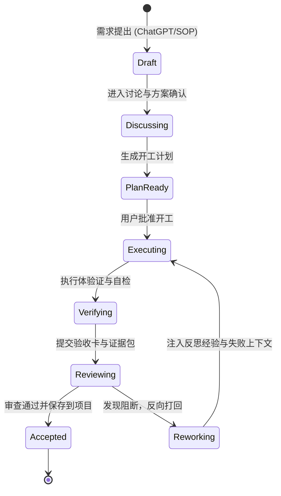

# AI Solo Studio 统一多 AI 协同交互协议规范草案 (2026)

**TASK_ID：AISS-P2-COLLAB-PROTOCOL-001**  
**编制时间：** 2026-11-23  
**适用范围：** AI Solo Studio 跨模型、跨工具、多智能体协同流水线  

---

## 一、协议目标

解决多 AI 研发场景下的“上下文断层”、“指令格式混乱”、“验收证据缺失”与“重试死循环”问题。  
本协议定义了从 **需求提出 -> 方案细化 -> 任务派发 -> 受控施工 -> 证据验收 -> 反馈修正** 的标准数据契约与状态机流转。

---

## 二、核心数据对象规范 (Data Models)

### 1. 任务工单契约 (`TaskWorkOrder`)

```typescript
export interface TaskWorkOrder {
  readonly version: '2026-11';
  readonly taskId: string;
  readonly projectId: string;
  readonly origin: 'chatgpt_web' | 'user_manual' | 'sop_blueprint' | 'autonomous_loop';
  
  // 核心意图与目标
  readonly intent: {
    readonly title: string;
    readonly promptText: string;
    readonly targetFiles?: readonly string[];
    readonly constraints: readonly string[];
  };

  // 依赖的工程上下文
  readonly context: {
    readonly requiredFiles: readonly string[];
    readonly learningRules: readonly string[]; // 来自 LearningEngine 的避坑准则
    readonly previousReviewComments?: readonly string[]; // 上一轮评审意见
  };

  // 派发目标执行体
  readonly routing: {
    readonly chiefExecutor: 'codex' | 'claude_code' | 'antigravity' | 'deepseek_api';
    readonly reviewer?: 'deepseek_api' | 'claude_api' | 'chatgpt_web';
    readonly sandboxMode: 'workspace_write' | 'read_only';
  };
}
```

### 2. 验收事实与证据包 (`ExecutionEvidenceBundle`)

```typescript
export interface ExecutionEvidenceBundle {
  readonly taskId: string;
  readonly runId: string;
  readonly timestamp: string;
  readonly outcome: 'success' | 'failed' | 'needs_rework';
  
  // 结构化验证指标
  readonly metrics: {
    readonly typecheckPassed: boolean;
    readonly unitTestPassed: boolean;
    readonly buildPassed: boolean;
    readonly smokePassed: boolean;
    readonly e2ePassed?: boolean;
  };

  // 关键日志与诊断
  readonly diagnostics: {
    readonly stdoutSummary: string;
    readonly stderrSnippet?: string;
    readonly diffStat?: string;
    readonly changedFiles: readonly string[];
  };
}
```

### 3. 多轮反馈意见 (`ReviewFeedbackMessage`)

```typescript
export interface ReviewFeedbackMessage {
  readonly round: number;
  readonly reviewerRole: 'chief_reviewer' | 'chatgpt_web_user' | 'system_guard';
  readonly verdict: 'approved' | 'rejected' | 'rework_requested';
  readonly critique: {
    readonly summary: string;
    readonly blockingIssues: readonly string[];
    readonly suggestions: readonly string[];
  };
}
```

---

## 三、协同状态机流转 (State Transition)



### 循环熔断控制 (Circuit Breaker)
- 单任务最多允许连续 3 次自动返工重试。
- 达到 3 次上限若仍未通过，强制触发熔断（`HALTED_MAX_RETRY_EXCEEDED`），弹出人工介入界面，禁止后台无休止刷 Token。
- 每次返工失败的根本原因自动提炼并记录至 `LearningEngine`，下次施工时强制置顶为前置避坑规则。

---

## 四、后续实施步骤 (P3/P5 规划)

1. 在 `src/core/collab/` 建立上述数据接口与 JSON Schema 校验。
2. 实现 `ChatGptWebBridge` 与 `CodexExecutor` 之间的双向事件总线。
3. 接入 `LearningStore`，打通自动沉淀与自动唤醒全链路。
