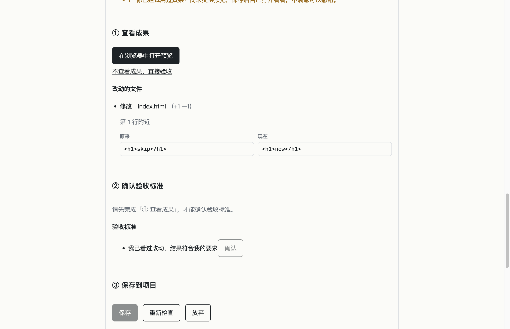
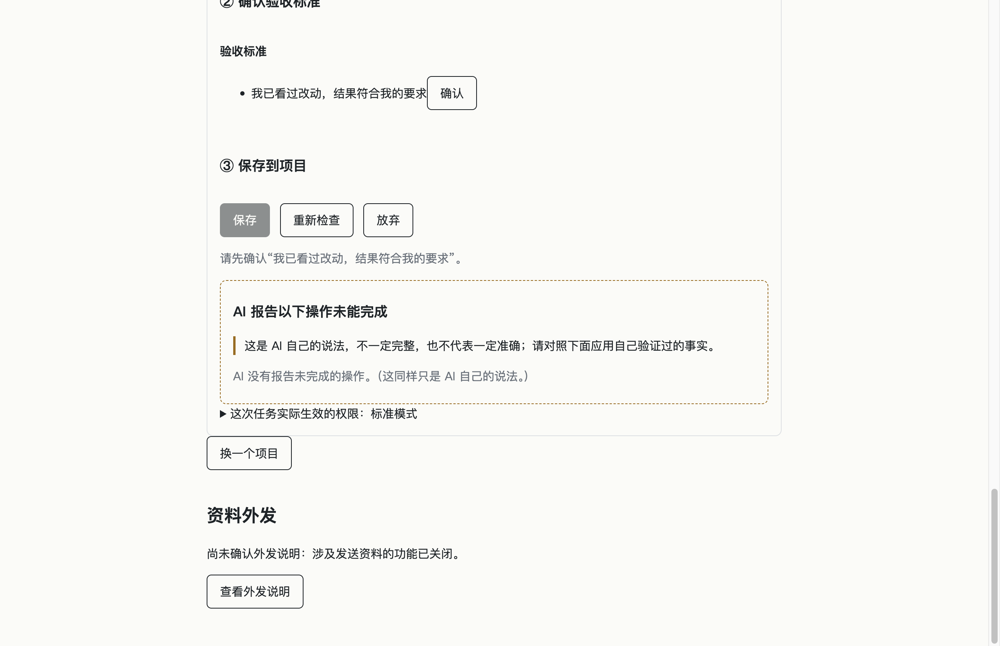

# 验收预览缺陷修复完成报告

- **日期**：2026-11-10
- **分支**：`rebuild`
- **关联提交基线**：`ee3aa37`（feat(acceptance): provide worktree preview for web and files in Finder before saving）

---

## 1. 每项修复内容说明（通俗解读）

### 修复 1：预览路径编码（特殊字符与中文路径处理）
当项目文件夹路径中包含中文、空格或 `#`、`%` 等特殊字符时，系统原先直接拼接文件路径会导致浏览器无法识别或打开空白错误页。现在通过标准的本地文件路径转链接工具（`pathToFileURL`），自动把这些特殊字符转为浏览器能百分之百准确识别的标准文件网址。即使你的项目放在带空格或符号的“我的 成果 #1”文件夹下，点击预览也能直接在浏览器中精准打开页面。

### 修复 2：打开失败不得记为“已查看”
之前如果预览由于系统缺少对应浏览器或路径不存在而打开失败，系统依然会误以为你已经看过了，直接允许进入下一步验收，容易造成没看成果就误操作。现在增加了严格的打开结果核对，只有成果真正在你的屏幕上成功打开后，系统才会记录为已查看。如果系统打不开成果，会明确弹出错误提示，引导你重试，或者由你自己主动决定跳过查看再进行验收。

### 修复 3：把“跳过查看”改成明确的选择与状态区分
以前界面只有“确认已查看”一个笼统按钮，如果用户打不开成果就必须被迫承认自己“已查看”，容易产生歧义与推卸责任。现在界面主按钮突出“打开预览”，并在下方提供清晰的辅助链接“不查看成果，直接验收”，点击时还会弹出防手误确认框，提醒用户尚未查看 AI 产物。选择跳过后，系统会在任务记录和界面上诚实、持久地标记为“已跳过查看”，既不卡死验收流程，又保证了操作记录的完全真实。同时，将所有界面用词统一为符合苹果系统原生习惯的“访达”。

---

## 2. 修复提交 GitHub 完整链接

| 修复项 | 提交信息 | GitHub 完整链接 |
| :--- | :--- | :--- |
| **修复 1** | `fix(acceptance): encode preview path with pathToFileURL to handle special characters` | [3f4b4ff2081712f952afc40017c58113ac6513c0](https://github.com/luckyjamesriver/ai-solo-studio/commit/3f4b4ff2081712f952afc40017c58113ac6513c0) |
| **修复 2** | `fix(acceptance): prevent marking viewed on open failure and require injected callback` | [542e5473368df258d82bcdf10db115fe0f56ca39](https://github.com/luckyjamesriver/ai-solo-studio/commit/542e5473368df258d82bcdf10db115fe0f56ca39) |
| **修复 3** | `fix(acceptance): replace confirmPreview with explicit skipPreview choice and persist skip state` | [e761e9b6d4cdd8a31977adaf708db72ddcc7c95f](https://github.com/luckyjamesriver/ai-solo-studio/commit/e761e9b6d4cdd8a31977adaf708db72ddcc7c95f) |

---

## 3. 本地全量测试数字

### 3.1 单元与集成测试（`npm test`）
- **测试文件（Test Files）**：24 passed | 11 skipped（共 35 个文件）
- **测试用例（Tests）**：**511 passed** | 37 skipped | **0 failed**（共 548 个用例）
- **执行耗时**：63.92s
- **安全基线**：`tests/security.test.ts` 中全部 40 项安全与架构边界断言 100% 通过（API 白名单、参数校验严格遵循规范，只增不减、不放宽任何已有规则）。

### 3.2 端到端测试（`npm run test:e2e`）
- **测试文件（Test Files）**：1 passed（共 1 个文件）
- **测试用例（Tests）**：**33 passed** | **0 failed**（共 33 个用例，新增 2 个端到端测试并全部绿色通过）
- **执行耗时**：115.93s

---

## 4. 过程中出现过的测试失败及原因分析

在编写与运行测试过程中，共经历过 1 处测试失败，均已彻底查明根本原因并规范修复，绝无跳过或掩盖：

- **测试用例**：`tests/b4-2-controller.test.ts` > `模拟打开失败 → previewed 仍为 false，第 ② 步仍锁定`
- **失败现象**：`AssertionError: expected undefined to be false`
- **根本原因**：测试代码在执行 `ctl.openPreview` 失败后，原先调用了 `const t = await ctl.get(id); expect(t.previewed).toBe(false);`。但 `ctl.get(id)` 返回的是对外渲染使用的 `TaskView` 视图对象，只包含任务列表渲染所需的字段，并不直接暴露内部领域实体 `Task` 的 `previewed` 与 `previewSkipped` 属性，导致取到 `undefined`。
- **处理方式**：改为通过测试辅助方法 `const t = await taskOf(repo, id)` 从底层 `TaskStore` 中读取落盘的完整领域模型对象，断言 `expect(t.previewed).toBe(false)` 立即通过。

---

## 5. 修复界面截图与说明

所有截图均在端到端测试执行过程中自动真实渲染并截取，保存在 `docs/screenshots/acceptance-fix/`：

### 5.1 预览打开失败时的提示
> 展示当外部浏览器或应用程序启动失败时，系统不将任务误记为已查看，第 ① 步保持未完成，第 ② 步保持锁定，并在界面显著位置展示友好错误提示：“无法打开成果，请重试，或选择不查看直接验收”。

---

### 5.2 “不查看成果，直接验收”确认框
> 展示用户在未查看成果时点击下方辅助链接“不查看成果，直接验收”弹出的防误触确认对话框：“你还没有查看 AI 做出的成果，确定直接进入验收吗？”，提供“确定直接进入验收”和“取消”按钮。

---

### 5.3 跳过后第 ① 步显示“已跳过查看”
> 展示用户确认跳过查看后，第 ① 步诚实显示“已跳过查看”（而非“已查看”），状态持久化保存在任务记录中，第 ② 步“确认验收标准”正常解锁。

---

## 6. GitHub CI 状态

- **分支**：`rebuild`
- **CI 运行链接**：[42659451928](https://github.com/luckyjamesriver/ai-solo-studio/actions/runs/42659451928)
- **触发推送提交**：`a61075f`
- **综合状态**：**Success**（一次通过，0 次重试，0 失败）

### 各 Job 运行明细：
1. **`test (ubuntu-latest)`**（Job ID: `129306738370`）：
   - 状态：**Success**（耗时 46s）
   - 执行阶段：
     - `Run npm run typecheck`：通过
     - `Run npm test`：通过（24 passed, 11 skipped, 0 failed）
     - `Run npm run build`：通过
2. **`test (macos-latest)`**（Job ID: `129306738848`）：
   - 状态：**Success**（耗时 5m1s）
   - 执行阶段：
     - `Run npm run typecheck`：通过
     - `Run npm test`：通过（24 passed, 11 skipped, 0 failed）
     - `Run npm run build`：通过
     - `Install Electron binary (macOS)`：通过
     - `Electron end-to-end (macOS)`：通过（33 passed, 0 failed，新增用例全部一次通过）

