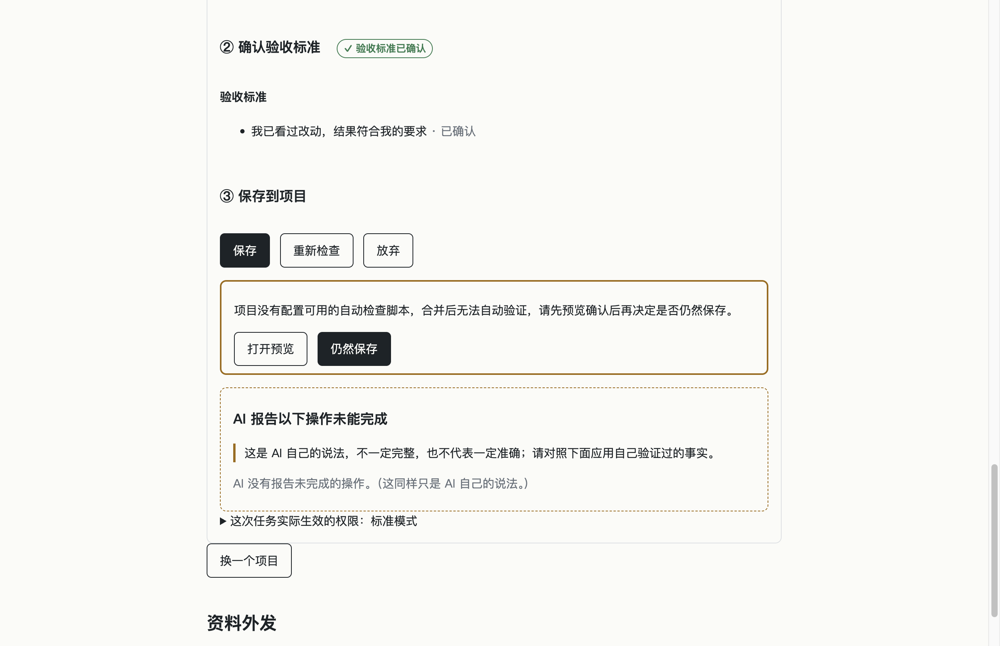

# 阶段 1 · 保存安全后台完成报告（UI v2.1 第 7、8 节）

- **日期**：2026-11-10
- **分支**：`rebuild`
- **基准提交**：`9baf901`（`docs(ui): freeze UI v2.1 spec and prototype`）
- **范围说明**：本阶段仅实现后台安全保存与最小必要界面文案，不新增界面布局、不做截图。

---

## 1. 四件事做了什么（通俗说明）

### 1）先试合并、试检查，再写入主项目
以前保存任务时会直接在你的项目主目录里做合并，如果合并出错或新旧代码合在一起跑不通测试，可能还得临时撤销现场。现在保存动作会先在一个看不见的临时副本里把改动合在一起，确认没冲突并重新跑一遍项目的构建和测试；只有全部通过后，才会再次核对你的项目期间没有被人改动，最后再一口气把结果写回主项目。无论最后成功还是中途失败、甚至检查程序意外报错，那个临时副本都会在结束时自动清理掉；每一步进度也都会记进日志，即使突然断电重启，系统也能分辨出究竟停在哪一步并安全收尾或提醒你处理。

### 2）保存记录增加检查信息
每次把任务保存到项目后，系统现在都会在保存记录里诚实记下「这次合并后有没有运行自动检查」「通过和失败了多少项」「检查时间」以及「试合并时的版本号」。在保存点列表、任务列表和结果页面上，只会用大白话标出「检查通过」或「未检查」，绝不把底层运行过的命令展示出来；如果项目本身没有配可用的自动检查，也绝不会假装标成「通过」或「安全」。

### 3）项目级锁
如果同一个项目里有任何一个任务在保存或撤销失败后进入「恢复未确认」的异常状态（`manualReview`），说明当前项目的文件状态可能不完整，系统就会立刻锁定这个项目的保存和撤销功能。在那个异常任务经人工处理解决之前，同一项目里的其他任务想要保存或撤销都会被拦下，并明确提示你先去处理那个异常任务，避免雪上加霜覆盖现场。

### 4）撤销：说清楚为什么不能撤销
为了防止破坏后续历史，只有最近一次落盘在项目顶端的保存才允许直接撤销，这一点规则保持不变。当某个较早保存的任务因为后面又保存了别的任务而无法单独撤销时，系统不再只给一句笼统的“项目还有其他修改”，而是沿着版本线把挡在它后面的那几个任务名字和保存时间一一列出来告诉你；本阶段仍不提供跨越多个后续保存强行撤销的功能。

---

## 2. 保存与操作结果对应表（`reason` 与用户看到的文案）

### 2.1 保存成功结果

| 结果条件 | 状态（`state`） | 核心返回（`message` / `checked`） | 用户在界面上看到的文案（结论 / 保存记录标识） |
|---|---|---|---|
| 试合并、试检查全部通过并写入主项目，副本清理成功 | `saved` | `ok: true`, `checked: true`, `message: "已保存到项目。"` | 结论：`已保存到项目。检查通过。`；保存记录标签：`检查通过` |
| 项目无可用检查（或无沙箱运行环境/授权失效），但试合并与写入成功 | `saved` | `ok: true`, `checked: false`, `message: "已保存到项目。"` | 结论：`已保存到项目。未检查。`；保存记录标签：`未检查`（绝不显示「通过」或「安全」） |
| 保存已成功写入主项目，但任务副本清理失败 | `saved_cleanup_pending` | `ok: true`, `checked: true/false`, `message: "已保存到项目。已保存，临时文件还没清理干净"` | 结论：`已保存到项目。已保存，临时文件还没清理干净（检查通过 / 未检查）`；保存记录标签：`检查通过` / `未检查` |

### 2.2 保存失败与拒绝结果（`OpFailReason`）

| `reason` | 触发场景 | 核心层 `detail` 示例 | 界面最终显示文案（经 `mapFailure` 收口，不透传原始错误/命令） |
|---|---|---|---|
| `busy` | 同一任务正在保存、放弃、撤销或检查中重复触发 | `这个任务正在进行另一项操作，请稍候。` | `这个任务正在进行另一项操作，请稍候。` |
| `not_ready` | 任务状态不在可保存阶段，或验收标准/检查存在前置阻塞 | `还有检查未通过或验收标准未确认。`（或具体阻塞项说明） | `还有检查未通过或验收标准未确认。`（按钮禁用态显示具体前置阻塞说明） |
| `project_locked` | 同项目存在处于 `manualReview` 状态的异常任务 | `项目中有任务「{任务名}」处于异常状态（恢复未确认），请先处理那个任务后再保存或撤销。` | `项目中有任务「{任务名}」处于异常状态（恢复未确认），请先处理那个任务后再保存或撤销。` |
| `external_driver` | 副本或主项目使用了 `filter` / `merge` / `diff` 外部驱动（含 `git-lfs`） | `这个项目使用了需要外部程序处理的文件类型，工作台暂不支持自动保存` | `这个项目使用了需要外部程序处理的文件类型，工作台暂不支持自动保存` |
| `repo_changed` | 主项目实际路径与开工绑定时不一致 | `项目的位置和开工时不同，工作台不会自动保存` | `项目的位置和开工时不同，工作台不会自动保存` |
| `branch_changed` | 主项目当前分支与开工绑定时不一致 | `项目当前所在的版本线和开工时不同，工作台不会自动保存` | `项目当前所在的版本线和开工时不同，工作台不会自动保存` |
| `dirty_main` | 主项目存在未提交改动 | `项目中还有其他未保存的修改，请先处理后再保存`（附相对路径清单） | `项目中还有其他未保存的修改，请先处理后再保存`（附文件清单） |
| `acceptance_invalid` | 确认后任务副本内容发生变化（与 `acceptedTree` 不一致） | `你确认之后，任务副本里的内容又发生了变化，原来的验收已失效，请重新检查后再保存。` | `你确认之后，任务副本里的内容又发生了变化，原来的验收已失效，请重新检查后再保存。` |
| `conflict` | 在临时 worktree 试合并发生冲突（主项目未触碰） | `AI 的修改与项目当前版本有冲突，工作台无法安全自动合并。本次没有保存，AI 的成果仍保留。` | `AI 的修改与项目当前版本有冲突，工作台无法安全自动合并。本次没有保存，AI 的成果仍保留。` |
| `checks_failed` | 试合并后的代码在临时 worktree 运行构建或测试未通过 | `合并后自动检查未通过（{构建/测试}），本次没有保存，你的项目保持原样。`（附 `failedChecks`） | `合并后自动检查未通过（{构建/测试}），本次没有保存，你的项目保持原样。` |
| `unchecked_needs_confirm` | 试检查为 `none`（无检查脚本）或 `unavailable`（沙箱不可用 / 合并改动检查脚本需重新授权 / 其他），且未传 `confirmUnchecked: true` | `none` / `unavailable` 对应原因（脚本变化时明确提示：`这次合并改动了项目的检查方式，所以没法自动检查。`） | 主项目不变，验收区步骤 ③ 下方展示原因与两个按钮：`打开预览`、`仍然保存`（同版本且最近一次为此结果时显示） |
| `project_changed` | 试检查期间主项目发生了新提交、工作区变脏或切分支 | `保存检查期间项目发生了新的变化，本次没有保存，你的项目保持原样，请重新保存。` | `保存检查期间项目发生了新的变化，本次没有保存，你的项目保持原样，请重新保存。` |
| `failed_restored` | `git merge --ff-only` 写入主项目失败，但核验与保存前完全一致 | `写入项目时出错，已安全恢复并核对与保存前一致。本次没有保存，任务成果仍保留。` | `写入项目时出错，已安全恢复并核对与保存前一致。本次没有保存，任务成果仍保留。` |
| `abnormal` | 写入失败后核验主项目与保存前不一致（或当前任务本身处于 `manualReview`） | `项目状态异常，请不要继续操作` | `项目状态异常，请不要继续操作`（当前任务进入只读锁定，同项目其他任务返回 `project_locked`） |
| `failed` | 试检查抛异常或其它非冲突 Git 错误（主项目保持原样） | 具体内部错误信息 | `这次操作没有成功，项目保持原样。你可以稍后重试。` |
| `undo_refused` | 撤销被拒：被后续工作台保存挡住，或存在未提交修改/手工提交/分支变化 | 有后续保存时：`在这次保存之后，还有后来的保存挡住了它，暂时不能只撤销这一项：「{任务名}」（{时间}）。`；否则：`这次保存之后项目还有其他修改，暂时不能只撤销这一项` | 有后续保存时列出阻塞任务名与时间；否则显示 `这次保存之后项目还有其他修改，暂时不能只撤销这一项` |

---

## 3. 提交链接、本地测试数字与 GitHub CI 结果

### 3.1 阶段提交完整链接（`rebuild` 分支）

| 序号 | 对应事项 | 提交信息 | GitHub 完整链接 |
|---|---|---|---|
| 1 | 先试合并、试检查，再写入主项目 | `feat(save): trial merge and run checks in temp worktree before main ff-only write` | [762cafd7024885ab2416b64811004d118814dbf5](https://github.com/luckyjamesriver/ai-solo-studio/commit/762cafd7024885ab2416b64811004d118814dbf5) |
| 2 | 保存记录增加检查信息与界面文案 | `feat(save): store check metadata in saveRecord and display check status without commands` | [5932544102d5cd61c13ea7587a15488766c30fc7](https://github.com/luckyjamesriver/ai-solo-studio/commit/5932544102d5cd61c13ea7587a15488766c30fc7) |
| 3 | 项目级锁（`manualReview` 锁定同项目保存/撤销） | `feat(save): lock project save and undo when any task requires manual review` | [14b688375e30dd263b87456c84cf5e547d84c2af](https://github.com/luckyjamesriver/ai-solo-studio/commit/14b688375e30dd263b87456c84cf5e547d84c2af) |
| 4 | 撤销拒绝时列出阻塞的后续保存任务名与时间 | `feat(undo): list blocking later studio saves when undo is refused` | [004261afe6b4ec4841902174cfae45a2ec7f3189](https://github.com/luckyjamesriver/ai-solo-studio/commit/004261afe6b4ec4841902174cfae45a2ec7f3189) |

### 3.2 本地全量测试数字

- **类型检查（`npm run typecheck`）**：通过（0 错误）
- **生产构建（`npm run build`）**：通过（`build:core` + `build:renderer` 均成功）
- **单元与集成测试（`npm test`）**：
  - 测试文件：**25 passed** | 11 skipped（共 36 个文件；跳过的 11 个为需 `STUDIO_REAL_CODEX=1` 才运行的真实 Codex 集成测试）
  - 测试用例：**526 passed** | 37 skipped | **0 failed**（共 563 个用例；含 `tests/save-safety.test.ts` 新增 15 个用例，全部通过）
  - 执行耗时：69.17s
  - 安全基线（`tests/security.test.ts`）：全部 40 项断言 100% 通过，未删除或放宽任何已有断言
- **端到端测试（`npm run test:e2e`）**：
  - 测试文件：**1 passed**（共 1 个文件 `e2e/shell.e2e.ts`）
  - 测试用例：**33 passed** | **0 failed**（共 33 个用例）
  - 执行耗时：132.91s

### 3.3 GitHub CI 运行结果

- **CI 运行链接**：[42760798966](https://github.com/luckyjamesriver/ai-solo-studio/actions/runs/42760798966)
- **触发提交**：`004261afe6b4ec4841902174cfae45a2ec7f3189`（分支 `rebuild`）
- **综合结论**：**Success**（双平台一次通过，0 失败）
  1. **`test (ubuntu-latest)`**（Job ID：`129645756562`，耗时 55s）：`typecheck`、`npm test`、`npm run build` 全部通过
  2. **`test (macos-latest)`**（Job ID：`129645756117`，耗时 3m33s）：`typecheck`、`npm test`、`npm run build`、`Install Electron binary (macOS)`、`Electron end-to-end (macOS)` 全部通过

---

## 4. 过程中出现的测试失败及原因分析

在编写与调试 `tests/save-safety.test.ts` 的过程中，共出现过 3 类测试失败（全部为测试替身写法导致的测试本身问题，均已查明根因并彻底修正，未跳过任何用例）：

1. **`RangeError: Maximum call stack size exceeded`（`ff-only` 失败与中断恢复用例）**
   - **现象**：运行 `tests/save-safety.test.ts` 中 `ff-only 失败且恢复一致`、`ff-only 失败且恢复不一致` 及后续 `中断恢复` 用例时出现无限递归栈溢出。
   - **根因**：文件顶部使用了 `vi.mock('../src/core/git/git.js', { spy: true })`，而测试函数内部又写了 `const realGit = G.git; vi.spyOn(G, 'git').mockImplementation(...)`，导致 `realGit` 获取到的是已被包装的 spy 对象而非原始函数，回调内再次调用 `realGit` 引发自递归；同时 `vi.restoreAllMocks()` 未把被覆盖的模块导出 spy 重置回真实实现，波及后续用例。
   - **处理**：改为通过 `const actualG = await vi.importActual<typeof G>('../src/core/git/git.js')` 获取真实未包装模块，并在 `afterEach` 中显式以 `vi.mocked(G.git).mockImplementation(actualG.git)` 恢复，随后全部通过。

2. **`Error: sandbox process crashed unexpectedly`（异常清理用例）**
   - **现象**：`临时 worktree 在检查抛异常时同样被清理` 用例在准备阶段 `makeConfirmedTask` 内部直接抛错退出，未进入 `runner.save()`。
   - **根因**：`TaskRunner.start()` 生成验收证据（`buildEvidence`）时也会调用 `sandboxRunner.runCommand`，无条件抛错的测试运行器在验收前就已经失败。
   - **处理**：修改测试替身 `throwingRunner`，仅当 `req.cwd` 处于 `.studio/trials/`（即试合并后的临时副本）时才抛出异常，确保在 `doSave` 的试检查步骤精确触发异常并验证 `finally` 对临时 worktree 的清理。

3. **`Error: git commit 失败` 与 `AssertionError: expected false to be true`（`project_changed` 外部提交用例）**
   - **现象**：首次运行 `写入前项目变了（在检查期间模拟另一次提交）` 时 `git commit` 失败，并在修正目录过滤后二次重跑时于「重新保存可成功」断言（`expect(r2.ok).toBe(true)`）失败。
   - **根因**：
     - 初版 `mutatingRunner` 未限制 `req.cwd` 必须处于 `.studio/trials/`，导致在 `makeConfirmedTask` 阶段（此时 `repoRef` 尚为 `''`）往当前工作目录误生成并提交了 `external.txt`（并在同阶段 `dirtyingRunner` 误写了一个 `wip.txt`）；
     - 加上 `.studio/trials/` 条件后，`mutatingRunner` 每次运行都会重复执行相同内容的 `git commit`，导致用例末尾验证“重新保存 `r2` 仍可成功”时因工作区无新改动而 `git commit` 报错。
   - **处理**：增加 `let injected = false` 标志确保外部提交仅在第一次试检查时注入一次；删除残留的 `wip.txt`，并在推送远端之前通过 `git rebase --onto` 从本地未推送分支历史中彻底移除误提交测试 commit（远端 `origin/rebuild` 自始至终保持干净）。

---

## 5. 与 `docs/ui/UI_v2.1.md` 第 8 节对照

| 第 8 节依赖的后台能力 | 阶段 1 后状态 | 说明 |
|---|---|---|
| 合并后在合并结果上重新运行检查 | **已完成** | 已实现在临时 worktree 中 `--no-ff` 试合并后复用 `checks/scripts.ts` 运行项目自动检查；不通过返回 `checks_failed` |
| 写入前再次核对项目未变 | **已完成** | 写入主项目前核对 `HEAD === preHead`、工作区干净、分支未变、无外部合并进行中；不一致返回 `project_changed` |
| 保存失败后核对项目与保存前一致，区分「已安全恢复 / 恢复未确认」 | **已完成** | `git merge --ff-only` 失败后沿用 `intact` 核验：一致返回 `failed_restored`，不一致写入 `manualReview` 并返回 `abnormal` |
| 恢复未确认时锁定该项目的保存 | **已完成** | 任一任务存在 `manualReview` 时，同项目其他任务的保存、撤销及只读预判均返回 `project_locked`；仅可通过现有人工处理流程解锁 |
| 覆盖前的影响分析与试合并检查 | **仍未做** | 冲突覆盖流程（第 11 屏）属后续阶段，本阶段保持冲突中止并保留成果 |
| 撤销前影响分析、撤销后检查、失败不改文件 | **部分完成** | 已实现拒绝撤销时列出第一父链上阻塞的后续 `studio` 保存任务名与时间（替代笼统 `undoRefused`）；「跨后续保存的撤销」及撤销后自动检查仍未做 |
| 退回修改：同一副本上的第 N 轮，保留各轮成果与证据 | **仍未做** | 属后续界面与流程阶段 |
| 证据绑定轮次 / 时间 / 环境；原始记录过滤 | **部分完成** | 保存记录 `saveRecord` 已记录 `checked`、`checksSummary`、`checkedAt`、`trialCommit` 且界面仅显示「检查通过 / 未检查」；完整轮次绑定与检查依据页仍未做 |
| 另一个文件夹的只读选项 | **仍未做** | 现仍为 `extraWritableDirs` |
| 多项目同时打开 | **仍未做** | 现仍为单项目模型 |
| 额度查询 | **仍未做** | 仍待后续调研 |

---

## 6. 补丁：未检查时必须由用户确认

### 6.1 做了什么（通俗说明）
1. **把“没能检查”拆成三类、不再直接保存**：`runProjectChecks` 现在明确区分 **没有配置检查脚本（`none`）**、**有脚本但至少一项没能运行（`unavailable`）**（写明沙箱不可用、合并后检查方式变化需重新授权或其他）以及 **全部实际运行（`ran`）**。只要结果不是全部通过而是“未检查”，第一次保存一律停在写主项目之前，清理临时副本并返回 `unchecked_needs_confirm`；如果合并前后改动了构建/测试脚本授权摘要，会明确提示“**这次合并改动了项目的检查方式，所以没法自动检查。**”。
2. **必须由用户点确认，且确认只对当前现场有效**：界面只在“最近一次保存停在 `unchecked_needs_confirm`、且验收版本与当时一致”的条件下，由主进程视图统一下发原因文案及「打开预览」「仍然保存」两个按钮。点「仍然保存」会走与普通保存完全相同的安全门禁（只是允许这次未检查继续），并重新走一遍试合并；如果两次点击之间主项目又被人改过，第二次保存会返回 `project_changed`，绝不复用上一次的试合并结果写入，且 `saveRecord` 会如实记下 `checked: false`、`uncheckedKind` 和用户确认时间 `uncheckedConfirmedAt`。
3. **测试专用开关锁定在测试环境**：`runChecks: false` 在所有生产源码入口与控制层中禁止出现并由 `tests/security.test.ts` 静态看守，同时 `TaskRunner` 构造时在非测试环境下直接拒绝，确保正式打包应用不会绕过检查。

### 6.2 「仍然保存」确认界面截图

### 6.3 补丁后本地测试与构建数字

- **类型检查（`npm run typecheck`）**：通过（0 错误）
- **生产构建（`npm run build`）**：通过（`build:core` + `build:renderer` 均成功）
- **单元与集成测试（`npm test`）**：
  - 测试文件：**25 passed** | 11 skipped（共 36 个文件；跳过的 11 个为需 `STUDIO_REAL_CODEX=1` 才运行的真实 Codex 集成测试）
  - 测试用例：**535 passed** | 37 skipped | **0 failed**（共 572 个用例）
  - 安全基线（`tests/security.test.ts`）：共 **43 passed | 0 failed**（原有 40 项未放宽，preload 白名单按安全规范显式扩充为 29 个方法并新增 3 项关于 `runChecks: false`、`confirmUnchecked` 隔离以及 `saveUncheckedTask` 等价安全拦截的断言）
- **端到端测试（`npm run test:e2e`）**：
  - 测试文件：**1 passed**（共 1 个文件 `e2e/shell.e2e.ts`）
  - 测试用例：**34 passed | 0 failed**（含新增的“未检查项目显示「打开预览 / 仍然保存」并截图后点击「仍然保存」完成保存”）
- **应用冒烟测试（`npm run smoke`）**：通过（29 项 `window.studio` 白名单与沙箱隔离校验通过）

### 6.4 补丁过程中的测试失败与处理

1. **既有单测受新门禁影响（`40 failed`，`6` 个测试文件）**
   - **原因**：引入“未检查必须先确认再写入”后，原有 `tests/b4-save.test.ts`、`tests/b4-2-controller.test.ts`、`tests/b4-sentinel.test.ts`、`tests/save-safety.test.ts`、`tests/runner.test.ts`、`tests/adr-0005-scenarios.test.ts` 中使用无脚本夹具（或 `runChecks: false`）直接保存的用例按新规则返回了 `unchecked_needs_confirm`（符合预期）。
   - **处理**：将专项断言改为验证“首次返回 `unchecked_needs_confirm` → 传 `confirmUnchecked: true` 后保存成功”，并将纯测撤销/锁/哨兵/并发的夹具按规范改为确认后保存或补充通过的自动脚本，未删减任何检查或跳过任何用例。
2. **新增测试代码类型错误（`npm run typecheck`，3 处）**
   - **原因**：`tests/b4-2-view.test.ts` 中新增 `it` 块插在了前一用例末尾 `c.actions` 断言之前导致作用域错位；`tests/save-safety.test.ts` 中直接访问联合类型 `SaveResult` 的 `.reason` 属性。
   - **处理**：修正作用域位置并改为 `toMatchObject({ ok: false, reason: 'unchecked_needs_confirm' })`，同时将 `createTrialWorktree` 调用次数改为通过 `vi.mocked(G.createTrialWorktree)` 核对，随后类型检查、单测与 E2E 一次全过。

### 6.5 补丁提交与 GitHub CI 记录
- **补丁提交**：`fix(save): require user confirmation when checks did not run` — [6a9746aa611245b675f736605881b253c527bcfb](https://github.com/luckyjamesriver/ai-solo-studio/commit/6a9746aa611245b675f736605881b253c527bcfb)
- **CI 运行链接**：[42766167423](https://github.com/luckyjamesriver/ai-solo-studio/actions/runs/42766167423)（**Success**，双平台通过）
  1. **`test (ubuntu-latest)`**（[129663056058](https://github.com/luckyjamesriver/ai-solo-studio/actions/runs/42766167423/job/129663056058)，耗时 40s）：`typecheck`、`npm test`、`npm run build` 全部通过
  2. **`test (macos-latest)`**（[129663056524](https://github.com/luckyjamesriver/ai-solo-studio/actions/runs/42766167423/job/129663056524)，耗时 4m31s）：`typecheck`、`npm test`、`npm run build`、`Install Electron binary (macOS)`、`Electron end-to-end (macOS)`（34/34）全部通过
