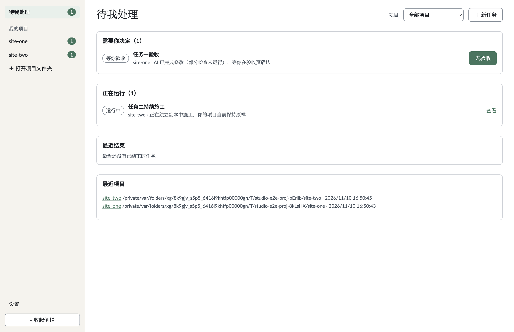
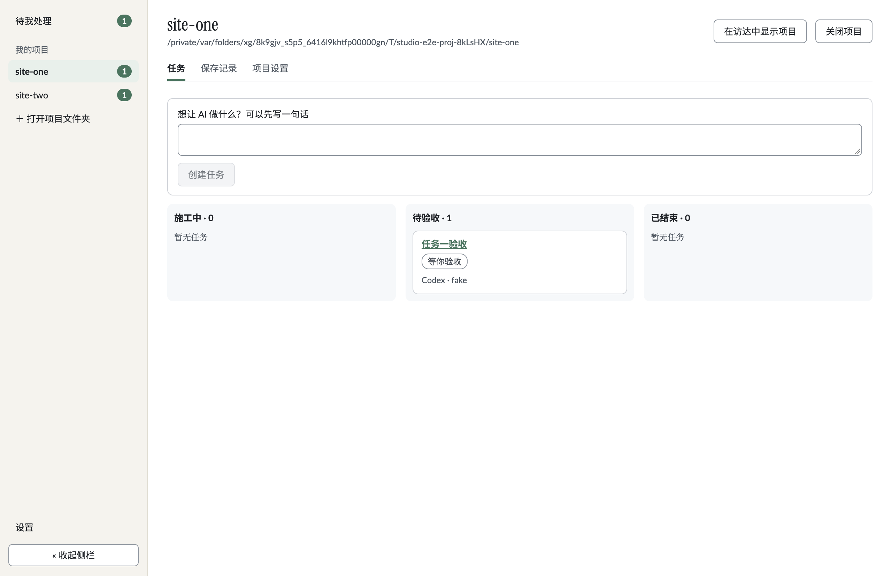
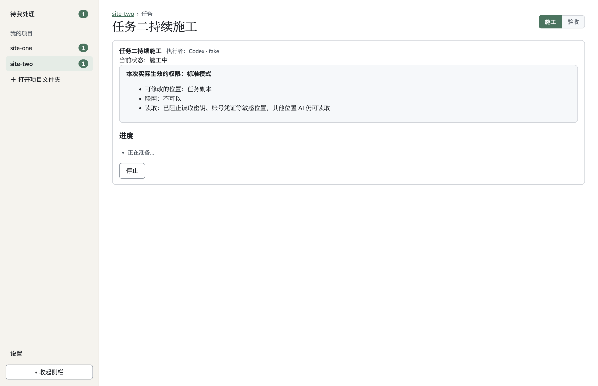
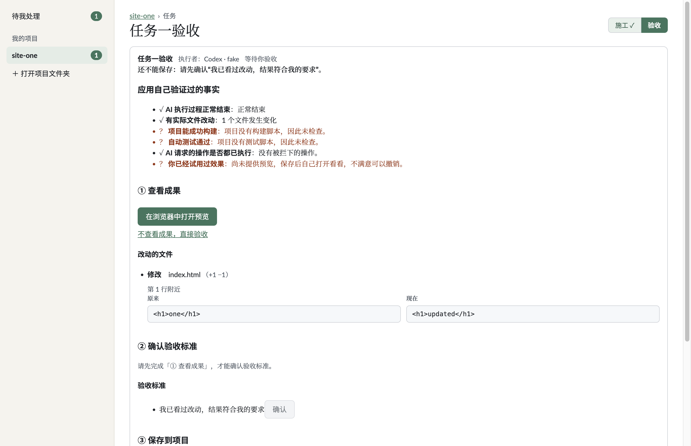
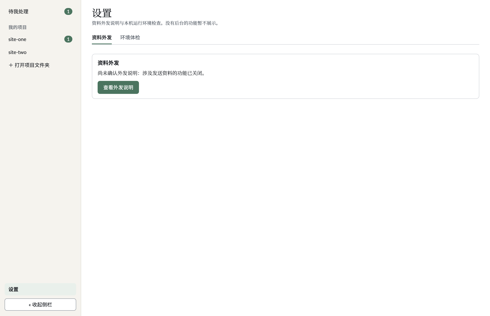
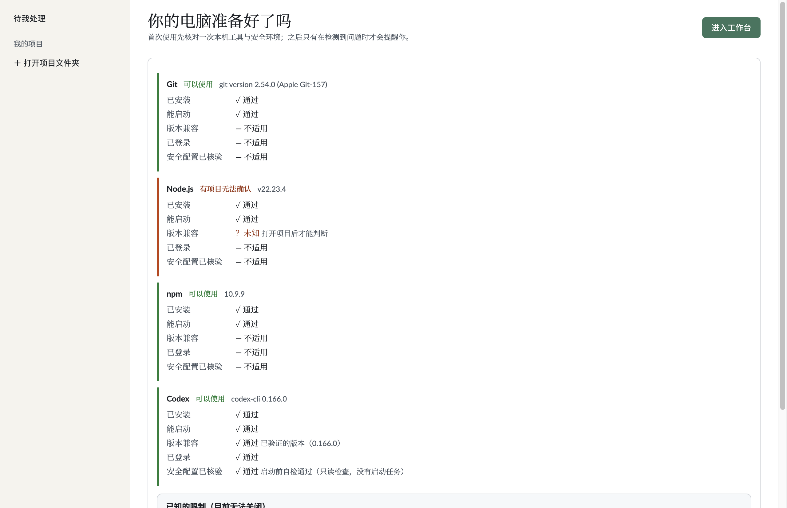
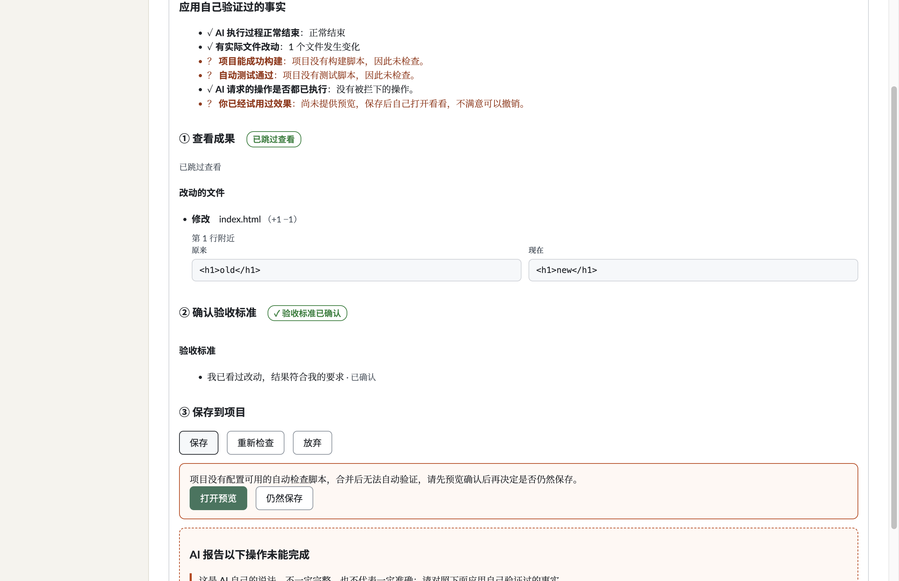

# 阶段 2 完成报告 · 多项目后台与 UI v2.1 应用外壳

- 仓库：`luckyjamesriver/ai-solo-studio`（分支 `rebuild`）
- 依据规范：[`docs/ui/UI_v2.1.md`](../ui/UI_v2.1.md)（已冻结，第 1、2、3、9、10 节）与可点击原型 [`docs/ui/prototype.html`](../ui/prototype.html)

---

## 1. 提交清单与内容摘要（大白话）

本阶段严格按先后台验证、再前端落地的顺序拆为 4 个提交：

1. **`feat(app): open multiple projects with per-project controllers`（`914d90c`）**
   - 把主进程里原本“只能开一个项目、切换即关闭旧项目”的全局变量替换成按 `projectId` 索引的「已打开项目表」（[`OpenProjectManager`](../../src/core/app/open-projects.ts)）。每个项目持有独立的 [`TaskController`](../../src/core/app/task-controller.ts) 和 `RecordStore`；打开第二个项目不会关闭第一个项目，正在施工的任务会继续运行。
   - 关闭项目改为显式操作（`projects:close`）：如果该项目仍有任务在施工/处理中，拒绝关闭并用大白话说明原因；停止并空闲后才能关闭，同时释放其存储租约；应用退出仍通过 `RecordStore.closeAll()` 统一释放全部锁。
   - 所有任务、项目状态与验收 IPC 最前面增加 `projectId` 参数，主进程先校验它是否属于已打开项目表（格式校验 + 表成员校验），未打开或伪造的 `projectId` 立即拒绝且不触碰任何项目。
   - 新增 `projects:listOpen`、`projects:close`、`workbench:get` 三个 IPC，并在核心层实现 UI v2.1 第 3 节全部 17 种 `TaskState` 到「阶段 + 运行状态 + 结局 + 工作台分组 + 对用户影响文案」的统一映射（[`task-state-view.ts`](../../src/core/app/task-state-view.ts)）。
   - 验证「项目级 `manualReview` 锁」严格隔离到所在项目，不影响同时打开的其他项目的保存与撤销。

2. **`feat(ui): design tokens and bundled fonts`（`072d451`）**
   - 在 [`src/renderer/tokens.css`](../../src/renderer/tokens.css) 建立完整的 UI v2.1 第 10 节视觉设计变量（颜色、字体栈、字号、字重、间距、圆角、侧栏与内容区宽度）与本地 `@font-face` 声明，不从网络加载任何字体。
   - 把 `Noto Serif SC`、`Noto Sans SC`、`Lato`、`Instrument Serif` 四套字体的子集化 `woff2` 文件与各自 SIL OFL-1.1 许可证文本放入 [`src/renderer/fonts/`](../../src/renderer/fonts/)，并在 [`ADR 0008 第 5 节`](../adr/0008-dependencies.md#L54) 逐项登记用途、来源、版本与许可证；不修改 `package.json`，构建期也不再运行字体生成脚本。
   - 全量清理 [`src/renderer/styles.css`](../../src/renderer/styles.css) 与组件中的硬编码颜色值，改为全部引用设计变量，并通过单元测试校验。

3. **`feat(ui): sidebar, workbench and project board`（`a5a0e4a`）**
   - 实现固定宽度（212px）且可手动收起的 [`Sidebar.tsx`](../../src/renderer/Sidebar.tsx)：包含「待我处理」角标、「我的项目」列表与各项目独立角标（有异常或 `manualReview` 锁定时显示橙色 `.cntw`）、「＋ 打开项目文件夹」、「设置」与收起按钮，宽度不随页面变化。
   - 实现跨项目工作台 [`Workbench.tsx`](../../src/renderer/Workbench.tsx)（`01-workbench`）：展示来自 `workbench:get` 的「需要你决定 / 正在运行 / 最近结束」三段与项目筛选下拉框、最近项目一键重开列表；文案完全由核心层下发，不出现命令。
   - 实现项目看板 [`ProjectBoard.tsx`](../../src/renderer/ProjectBoard.tsx)（`02-project`）：标签页为「任务 / 保存记录 / 项目设置」；看板列按三层状态映射到「施工中 / 待验收 / 已结束」（阶段 2 暂隐藏尚无后台的「讨论中」列）；卡片固定按「任务名 → 当前状态 → AI 与辅助信息」排列；支持在项目栏内显式「关闭项目」及被拒绝提示。
   - 在主进程 `AppStore` 新增首次环境体检引导完成状态持久化与 `healthProbe` 接入，为工作台与首次引导提供后台支持。

4. **`feat(ui): task page frame and settings shell`（`09d7184`，及紧随其后的工作台竞态修复提交）**
   - 新增任务页外框 [`TaskPage.tsx`](../../src/renderer/TaskPage.tsx)：固定顶部展示「项目 › 任务」面包屑、任务标题与两步阶段条（「施工 / 验收」，讨论阶段在阶段 5 前不展示）；原有的 `PlanCard` / `RunView` / `Acceptance` 原样放入外框并统一使用新配色与字体，内部安全与验收逻辑不变。
   - 新增首次启动环境体检引导 [`EnvOnboarding.tsx`](../../src/renderer/EnvOnboarding.tsx) 与共用组件 [`HealthList.tsx`](../../src/renderer/HealthList.tsx)：首次启动展示引导并可一键进入工作台；再次启动直接进入工作台，仅当检测到未通过项时在工作台「需要你决定」提示并支持跳转至「设置 → 环境体检」。
   - 新增全局设置外框 [`SettingsPage.tsx`](../../src/renderer/SettingsPage.tsx)（「资料外发 / 环境体检」）与项目设置内容（仅保留有后台支撑的「新任务预选模式」「项目风险说明」）。
   - 按 B9 按钮层级规范统一每屏仅保留一个实心主按钮，把高风险操作（「仍然保存」、放弃、撤销确认、「完全信任模式确认」）改为次要描边按钮，把阶段 1 未检查确认面板中的「打开预览」升为主按钮。
   - 紧随提交修复 macOS CI（`42784305957`）暴露的 `approved` + `isLiveRunning` 状态分类竞态：正在准备 worktree 的已批准任务在工作台归入「正在运行」，并同步补强单元测试与 [`03-task-building.png`](../screenshots/stage2/03-task-building.png) 截图。

---

## 2. `TaskState` 三层状态映射表

实现位于 [`src/core/app/task-state-view.ts`](../../src/core/app/task-state-view.ts) 的 [`classifyTaskState`](../../src/core/app/task-state-view.ts#L104)，单元测试 [`tests/multi-project.test.ts`](../../tests/multi-project.test.ts) 已静态穷举覆盖 `TaskState` 全部 17 个枚举值及关键 `manualReview` / `exit` / `saveRecord` 组合：

| `TaskState`（及附加条件） | 阶段（`stageLabel`） | 看板列 | 运行状态标签（`runStatus`） | 结局（`outcomeLabel`） | 工作台分组 | 异常标示 |
|---|---|---|---|---|---|---|
| `draft` | 施工 | 施工中 | 待配置计划 | — | 需要你决定 | 否 |
| `clarifying` | 施工 | 施工中 | 等你裁决 | — | 需要你决定 | 否 |
| `planned` | 施工 | 施工中 | 待开工确认 | — | 需要你决定 | 否 |
| `approved`（`isLiveRunning=true`） | 施工 | 施工中 | 运行中 | — | 正在运行 | 否 |
| `approved`（`isLiveRunning=false`） | 施工 | 施工中 | 待开工确认 | — | 需要你决定 | 否 |
| `running` | 施工 | 施工中 | 运行中 | — | 正在运行 | 否 |
| `exec_succeeded`（`isLiveRunning=true`） | 施工 | 施工中 | 运行中 | — | 正在运行 | 否 |
| `exec_succeeded`（`isLiveRunning=false`） | 施工 | 施工中 | 运行中 | — | 需要你决定 | 否 |
| `exec_failed` | 施工 | 施工中 | 失败 | — | 需要你决定 | 是 |
| `stopped` | 施工 | 施工中 | 已停止 | — | 需要你决定 | 否 |
| `timed_out` | 施工 | 施工中 | 已中断 | — | 需要你决定 | 是 |
| `reviewing`（正常 / `uncheckedConfirm` / 检查未通过） | 验收 | 待验收 | 等你验收 | — | 需要你决定 | 否 |
| `reviewing`（`exit.kind === 'stopped'`） | 验收 | 待验收 | 已停止 | — | 需要你决定 | 否 |
| `reviewing`（`timed_out` / `signaled`） | 验收 | 待验收 | 已中断 | — | 需要你决定 | 是 |
| `reviewing`（`exit` 非 0 异常退出） | 验收 | 待验收 | 失败 | — | 需要你决定 | 是 |
| 任意任务含 `manualReview`（恢复未确认锁） | 按原阶段 | 按原列 | **已锁定** | 按原结局 | **需要你决定** | **是** |
| `save_failed_unmerged` | 验收 | 待验收 | 被阻断 | — | 需要你决定 | 是 |
| `saved` | 已结束 | 已结束 | — | 已保存 | 最近结束 | 否 |
| `saved_cleanup_pending` | 已结束 | 已结束 | 被阻断 | 已保存 | 需要你决定 | 是 |
| `discarded` | 已结束 | 已结束 | — | 已放弃 | 最近结束 | 否 |
| `discard_cleanup_pending` | 已结束 | 已结束 | 被阻断 | 未完成而终止 | 需要你决定 | 是 |
| `undone` | 已结束 | 已结束 | 已撤销保存 | 未完成而终止 | 最近结束 | 否 |
| `undo_failed` | 已结束 | 已结束 | 失败 | 已保存 | 需要你决定 | 是 |

注：`讨论中` 列与阶段条中的「讨论」段按本阶段范围要求（B5/B6）先隐藏，待阶段 5 实现讨论引擎后再启用；工作台另会接入本机环境健康探测器（`health_issue`），在检测到 `fail` 项时向「需要你决定」追加一条可跳转「设置 → 环境体检」的异常条目。

---

## 3. `tests/security.test.ts` 逐条变更说明（A3 审计）

除 A3 授权的多项目 IPC 清单与 `projectId` 归属校验断言外，未删除或放宽任何原有断言：

| 原行号 / 现行号（相对 `633be4a`） | 变更内容 | 变更原因 |
|---|---|---|
| 原 277–281 / 现 277–280 | 把固定 `preload` API 清单从 29 项更新为 32 项（在 `openRecent` 后登记 `listOpenProjects`、`closeProject`、`getWorkbench`），并把 `SHAPES` 中原各任务/项目状态/验收参数前缀同步为精确的 `projectId: string`（零宽松类型、`Record`/`any` 等仍被拒绝） | A2 要求全部任务与验收 IPC 最前增加 `projectId: string` 并新增 3 个项目/工作台方法，按 A3 同步清单与精确形态 |
| 原 293 / 现 292 | `MAIN_SHAPES` 同步增加 `'_e, projectId: unknown'` 及以 `'_e, projectId: unknown, ...'` 为前缀的精确签名清单 | 与主进程 `ipcMain.handle` 签名一一对应（只增前缀，不放宽参数形态） |
| 原 462–478 / 现 461–480 | 「新增 IPC 的 preload 方法」测试块中把 12 个验收方法签名同步加上 `projectId: string`，补充 `listOpenProjects: ''`、`closeProject: 'projectId: string'`、`getWorkbench: ''` | A3 同步清单与参数校验 |
| 原 664–665 / 现 666–667 | `saveUncheckedTask` 正则匹配从 `(id: string, version: string)` 与 `tasks()` 更新为 `(projectId: string, id: string, version: string)` 与 `controllerFor(projectId).saveUncheckedTask(id, version)` | `confirmUnchecked` 门禁测试同步到带 `projectId` 的主进程路由 |
| 原 785 末尾 / 现 789–852（新增） | 新增 `describe('阶段 2 第一部分：多项目归属校验（只增不减）')` 两条测试：1）静态扫描验证 `src/main/index.ts` 中全部 22 个带 `projectId` 的 `ipcMain.handle` 处理函数都首先经过 `controllerFor(projectId)` / `projectStatus(projectId)` / `openProjects.close(projectId)` 并校验 `PROJECT_ID_RE` 与表成员（带反例自证）；2）运行时测试向 `OpenProjectManager.require` / `setActive` / `close` 传入伪造与未打开的 `projectId`（`'../evil'`、`'../../etc/passwd'`、`'OPEN-UPPER'`、`'unopened-proj'`、`''`、`null`、`123`），确认全部拒绝且不触碰已打开项目 | A3 要求验证每个带 `projectId` 的处理函数先校验项目在已打开表中 |

---

## 4. 字体文件大小、子集与许可证登记

- 全部字体基于官方 `github.com/google/fonts` 的 OFL-1.1 源码离线子集化生成后静态提交至 [`src/renderer/fonts/`](../../src/renderer/fonts/)，未新增任何 npm 依赖，构建时不运行字体工具。
- 中文两款字体保留 GB2312 一级+二级汉字及常用标点/界面符号（共 7,554 个码点），缺失生僻字由系统字体栈兜底（`Songti SC` / `PingFang SC`）；英文两款字体保留 Basic Latin、Latin-ext 与界面标点符号。

| 文件名 | 大小（字节 / KiB） | 用途 | 版本 | 许可证 |
|---|---|---|---|---|
| `InstrumentSerif-Regular.woff2` | `13,312` B（`13.0 KB`） | 页面大标题（26px 常规字重） | `1.000` | OFL-1.1（`InstrumentSerif-OFL-1.1.txt`） |
| `Lato-Regular.woff2` | `45,564` B（`44.5 KB`） | 英文正文与常规控件 | `2.015` | OFL-1.1（`Lato-OFL-1.1.txt`） |
| `Lato-Bold.woff2` | `45,312` B（`44.2 KB`） | 英文小标题、标签与强调 | `2.015` | OFL-1.1（`Lato-OFL-1.1.txt`） |
| `NotoSansSC-VF.woff2` | `1,870,600` B（`1,826.8 KB`） | 中文小标题、标签、按钮、导航与表单（`wght 400–700`） | `2.004` | OFL-1.1（`NotoSansSC-OFL-1.1.txt`） |
| `NotoSerifSC-VF.woff2` | `2,558,860` B（`2,498.9 KB`） | 中文正文与大标题中文回落（`wght 400–700`） | `2.003` | OFL-1.1（`NotoSerifSC-OFL-1.1.txt`） |
| **字体文件合计** | **`4,533,648` B（`4.32 MiB`）** | — | — | **全部经维护者批准 OFL-1.1，已记入 [`ADR 0008`](../adr/0008-dependencies.md#L54)** |

**打包前后 `dist-renderer/` 体积变化**：
- 提交 1 基线（不含本地字体）：`262,760` B（约 `256.6 KiB`）
- 提交 2（仅引入设计与字体，不含新版外壳逻辑）：`4,802,047` B（增量 **`+4,539,287` B**，其中字体资产 `4,533,648` B + `@font-face`/设计变量 CSS `5,639` B）
- 提交 4 最终（含完整外壳与字体）：`4,824,821` B（相对基线总增量 **`+4,562,061` B**）

---

## 5. 与原型（`docs/ui/prototype.html`）不一致处及原因

1. **侧栏不放底部「额度」状态行**：原型第 65 行有「额度：Codex 可用 · Claude 可用」，目前尚无额度查询后台，按规范第 0/9 节与任务要求 B3 省略，不放置虚假状态或占位。
2. **「每屏一个主操作」严格收紧按钮层级**：原型工作台 `01-workbench` 同时存在多枚 `.pri` 按钮（顶部 `＋ 新任务` 与列表里的多个 `去裁决`/`去验收`）。按任务要求 B9，工作台真实界面仅把首条「需要你决定」（无待决定时为顶部开项目/新任务入口）设为实心主按钮，其余操作与风险操作（放弃、撤销、完全信任确认、「仍然保存」）统一用次要描边或链接按钮。
3. **工作台增加「最近项目」列表**：原型假设已有项目打开，真实桌面应用重启后「已打开项目表」初始为空，因此复用现有的 `recentProjects` / `openRecent` 在工作台底部保留最近项目快捷入口。
4. **项目看板隐藏「讨论中」列（只显示 施工中 / 待验收 / 已结束 三列）**：按 B5 规定，目前阶段 5 尚未实现讨论后台，暂不展示空列。
5. **任务页阶段条只显示两步（「施工 / 验收」）**：原型显示「1 讨论 → 2 施工 → 3 验收」，按 B6 暂时隐藏「讨论」阶段。
6. **全局设置只保留「资料外发 / 环境体检」两个标签页**：原型 `13-settings` 中的「AI 与角色 / 额度与接手 / 额度详情」尚无对应后台，按 B7 与规范第 9 节不渲染无后台入口。
7. **项目设置只保留「新任务预选模式（只读实时状态）」与「项目风险说明」**：原型 `14-project-settings` 中的角色覆盖、扩展能力启用开关、自动检查总览与手动预设下拉变更接口暂未接入，按 B7 只真实展示已有 `TaskPrefs` 预选模式与风险/外发入口。
8. **首次环境体检引导 + 异常再提醒**：原型无独立引导页，按 B8 首次启动展示独立环境体检引导页，之后重启直接进工作台，仅在检测到 `overall === 'fail'` 时在「需要你决定」提示并跳转「设置 → 环境体检」。
9. **原样保留 `PlanCard` / `RunView` / `Acceptance` 内容结构**：按范围要求，阶段 3–5 才会按原型 `03`–`11` 重构内部版式，本阶段只把它们装进任务页外框，替换新的设计变量与字体并落实 B9 按钮层级。
10. **去掉原型顶部的静态 `.toc` 目录，锁定浅色设计变量**：`.toc` 仅服务静态原型跳转；真实界面移除旧版暗色 `prefers-color-scheme: dark` 覆盖，严格采用 UI v2.1 §10 的暖纸/深青配色。

---

## 6. 阶段 2 截图索引（`docs/screenshots/stage2/`）

| 截图 | 对应原型锚点 / 规范条目 | 说明 |
|---|---|---|
|  | `01-workbench`（B4） | 工作台汇总「需要你决定 / 正在运行 / 最近结束」、按项目筛选、侧栏独立角标与单主按钮 |
|  | `02-project`（B5） | 三列表格看板（隐藏空的讨论中）、标签页与卡片三段信息顺序、左侧对齐标题 |
|  | `05-build`（B6） | 「项目 › 任务」面包屑、任务大标题、两步阶段条（「施工」高亮）与既有 `RunView` |
|  | `07-accept`（B6） | 阶段条推进到「施工 ✓ → 验收」与分步验收卡 |
|  | `13-settings`（B7） | 仅含「资料外发 / 环境体检」标签页，无空占位 |
|  | B8 | 首次启动展示的 5 层环境检查引导与「进入工作台」主按钮 |
|  | `10-save-result`（B9） | 「打开预览」升为实心主按钮，风险操作「仍然保存」「放弃」均为次要描边按钮 |

---

## 7. 验证结果、CI 链接与过程中的失败记录

### 最终本地验证数字（竞态修复及重拍截图后全量实跑，无删改或放宽断言）
- `npm run typecheck`：通过（0 错误）
- 单元测试（`npx vitest run --maxWorkers=4`）：**27 个测试文件、544 项测试全部通过**（另有 11 个 `tests/integration/*.real.test.ts` 测试文件共 37 项因未设置 `STUDIO_REAL_CODEX=1` 按既有配置跳过，0 失败）
- Electron 端到端测试（`E2E_STAGE2_SHOT_DIR=docs/screenshots/stage2 npm run test:e2e`）：**1 个测试文件、37 项测试全部通过**（耗时 `152.29s`，并同步刷新阶段 2 全部 7 张截图）
- 桌面冒烟测试（`npm run smoke`）：**全部 6 项检查通过**，正常退出 `code=0`

### GitHub CI 状态
- **第一部分（Commit 1 · `914d90c`）CI 通过**：[`https://github.com/luckyjamesriver/ai-solo-studio/actions/runs/42780381268`](https://github.com/luckyjamesriver/ai-solo-studio/actions/runs/42780381268) — `test (ubuntu-latest)`（`1m3s`）与 `test (macos-latest)`（`5m29s`，含 35 项 Electron 端到端测试）均 `success`。
- **第二部分初推（Commit 2–4 · `072d451`..`09d7184`）**：[`https://github.com/luckyjamesriver/ai-solo-studio/actions/runs/42784305957`](https://github.com/luckyjamesriver/ai-solo-studio/actions/runs/42784305957) — `test (ubuntu-latest)`（`46s`）`success`；`test (macos-latest)` 36/37 通过，仅在 `e2e/shell.e2e.ts:1226` 暴露一处状态分类竞态（详见下方第 7 条）。修复提交与更新后的本报告将推送至 `rebuild` 进行新一轮双平台 CI 验证。

### 过程中的所有失败及修复
1. **`tests/security.test.ts:816` 报 `ReferenceError: os is not defined`**：新增的 `OpenProjectManager` 运行时安全测试调用了 `os.tmpdir()` 但测试文件顶部未引入 `node:os`；在测试块内补充 `await import('node:os')` 后通过。
2. **`tests/multi-project.test.ts` 三项失败（`Error: 请先保存计划` 与状态等待超时）**：一是直接调用了 `ctl.start()` 而未先调 `ctl.savePlan()`；二是 `TaskController` 每个控制器只实例化一次 `FakeExecutor`，按数组 `shift()` 会在多任务时重复执行第一个 `{ do: 'hang' }` 剧本；改为按 `prompt` 切换剧本并先保存计划后通过。
3. **`e2e/shell.e2e.ts` 新加第一部分多项目 E2E 报错 `wbRunningCount === 0`**：`startTask` 在异步创建 worktree 前就立刻调用 `getWorkbench()`；补充轮询等待 `getTask` 进入 `running` 及 `stopTask` 退出 `running` 后稳定通过。
4. **全量并行 `npm test` 下 `tests/security.test.ts:677` 与 `tests/save-safety.test.ts:807` 的表现**：
   - `tests/security.test.ts:677` 在本机 20 核默认满并发下因 `makeCtlTask` 单条测试内顺序初始化 5 个 Git 仓库与 worktree 受 APFS/锁竞争拖慢跨越 20 秒超时（该测试单独运行约 12–14 秒，在 GitHub `ubuntu-latest` 约 4 秒、`macos-latest` 约 10.7 秒；本机以 `--maxWorkers=4` 运行则全量 544 项一次通过且严格不修改或放宽 `security.test.ts` 第 677 行）。
   - `tests/save-safety.test.ts:807` 偶现 `无效的参数`：因旧版 `acceptanceView` 未把 `TaskController.active` 计入 `busy` 且测试仅用 `while (view.busy)` 等待；已在 [`task-controller.ts`](../../src/core/app/task-controller.ts#L258) 的 `acceptanceView` 中加入 `this.active.has(t.id)`，并把该测试等待条件收紧为 `view.busy || view.state !== 'reviewing'`（设 500 轮上限防死循环）。
5. **`e2e/shell.e2e.ts:185` Playwright 严格模式冲突（`strict mode violation`）**：空工作台顶部入口与侧栏都命名为「打开项目文件夹」，导致 `getByRole('button', { name: '打开项目文件夹' })` 匹配两个按钮；将工作台空态头部按钮文案调整为「＋ 打开项目」后消除冲突，37 项端到端测试一次全过。
6. **看板卡片标题视觉居中对齐偏移**：截图审阅发现 [`02-project-board.png`](../screenshots/stage2/02-project-board.png) 中 `.card-title` 继承了 `button { justify-content: center }` 导致卡片标题居中；补充 `.card-title { justify-content: flex-start; text-align: left; }` 后重新构建、全跑测试并重拍截图验证对齐正确。
7. **macOS CI 运行 [`42784305957`](https://github.com/luckyjamesriver/ai-solo-studio/actions/runs/42784305957) 暴露 `e2e/shell.e2e.ts:1226` 超时（`TimeoutError: page.waitForFunction` 等待 `[data-testid="wb-running"]` 包含 `'任务二持续施工'`）**：
   - 根因：点击「开始施工」后任务立即进入 `TaskController.active`（异步创建 worktree 期间持久化状态仍为 `approved`），但 [`classifyTaskState`](../../src/core/app/task-state-view.ts) 对 `approved` 一律归为 `workbenchGroup: 'needs_decision'` 且 `isRunning: false`；快速切回工作台读取到 `counts.running === 0`，导致 `App.tsx` 关闭 `shouldPoll` 轮询，后续 `approved → running` 迁移不会被工作台自动刷新。
   - 修复：在 `classifyTaskState` 的 `approved` 分支按 `opts.isLiveRunning` 区分——活跃施工中返回 `workbenchGroup: 'running'`、`runStatus: '运行中'`、`isRunning: true`；在 [`tests/multi-project.test.ts`](../../tests/multi-project.test.ts) 增补 `approved` 与 `isLiveRunning` 组合断言，并在 [`e2e/shell.e2e.ts`](../../e2e/shell.e2e.ts) 拍摄 `03-task-building.png` 前增加等待 `run-view` 出现 `[data-testid="perm-summary"]` 的步骤。修复后本地 `typecheck`、544 项单元测试、37 项 E2E 与 6 项冒烟检查全部通过。
