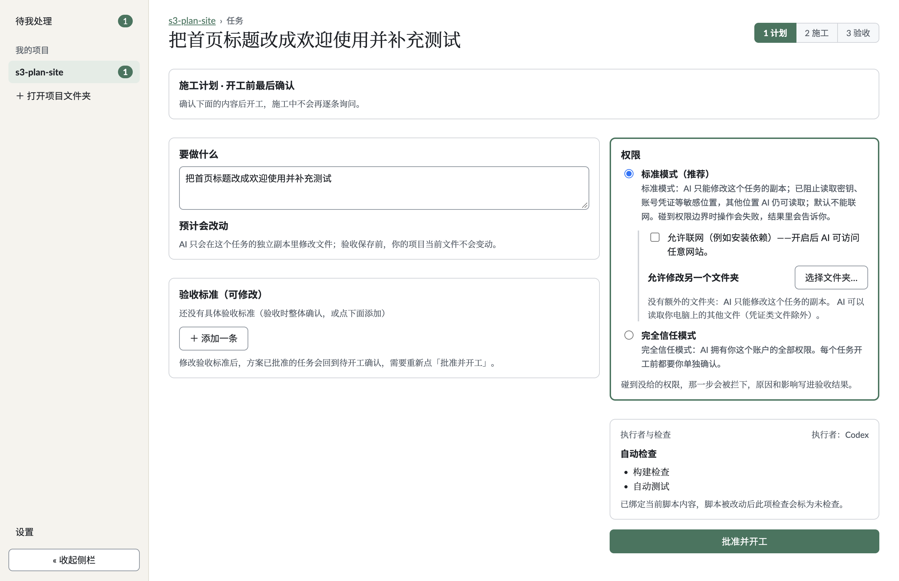
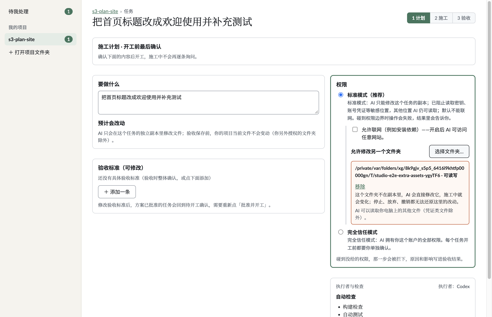
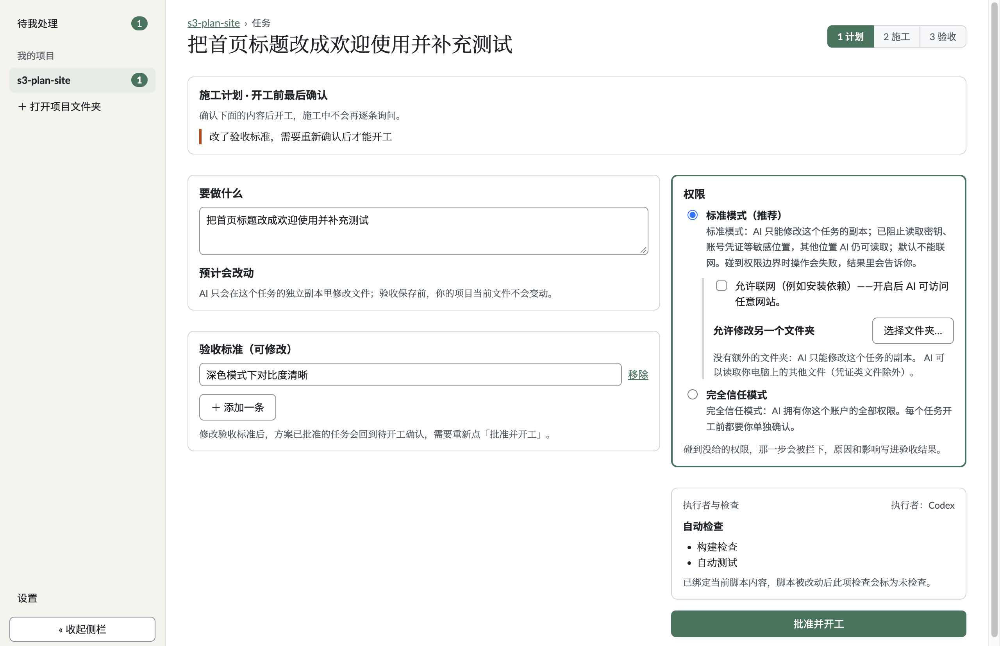
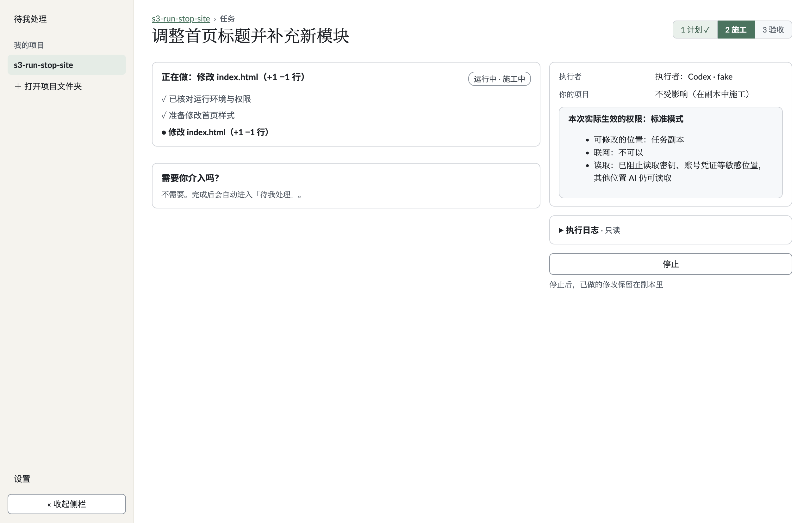
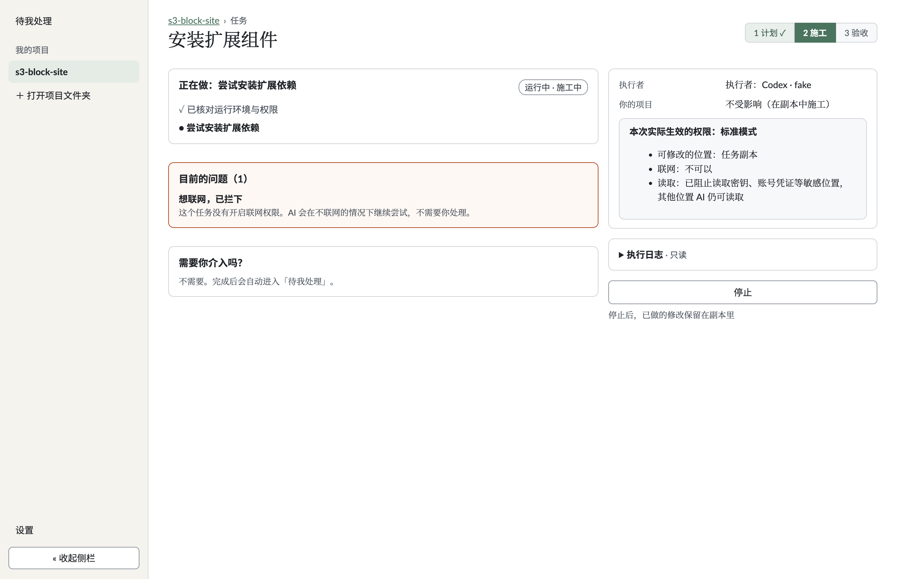
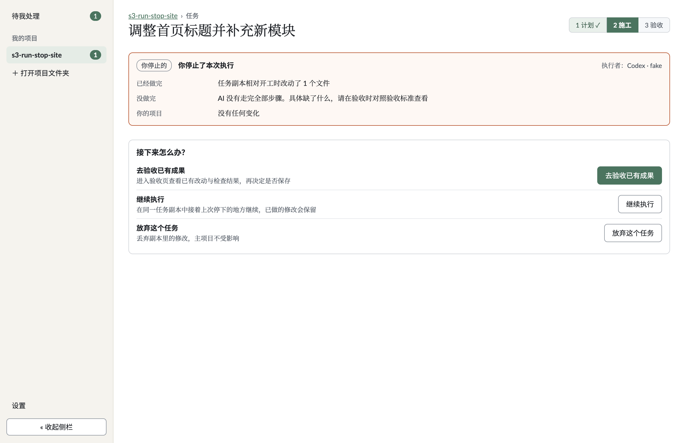
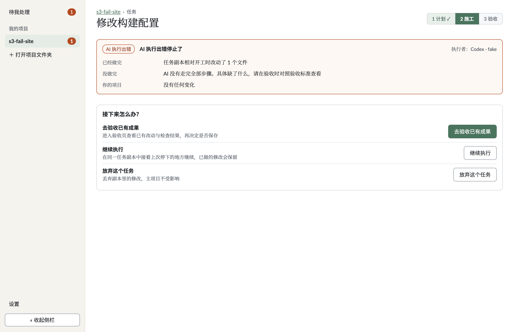

# 阶段 3 完成报告 · 施工计划确认页、施工中页、停止 / 中断后页与状态文案对齐

- 仓库：`luckyjamesriver/ai-solo-studio`（分支 `rebuild`）
- 依据规范：[`docs/ui/UI_v2.1.md`](../ui/UI_v2.1.md)（已冻结，第 5、9 节）与可点击原型 [`docs/ui/prototype.html`](../ui/prototype.html)（`#04-plan`、`#05-build`、`#06-stopped`）

---

## 1. 提交清单与内容摘要（大白话）

本阶段按既定顺序拆为 4 个提交：

1. **`feat(plan): plan confirmation page`（`1081343`）**
   - 把 [`PlanCard.tsx`](../../src/renderer/PlanCard.tsx) 改造为原型 `#04-plan` 两栏版式：左栏展示「要做什么 / 预计会改动 / 验收标准（可逐条增删改并保存）」，右栏展示「权限（标准模式下的联网和额外文件夹缩进展示）/ 执行者与自动检查 / 唯一实心主按钮 `批准并开工`」。
   - 在 [`model.ts`](../../src/core/task/model.ts)、[`runner.ts`](../../src/core/task/runner.ts) 与 [`task-view.ts`](../../src/core/app/task-view.ts) 中记录并清除 `reapproveNotice`：当任务处于 `approved`（已批准未开工）状态而用户在计划确认页修改验收标准时，`savePlan` 会触发 `edit_plan` 退回 `planned`、清除 `fullTrustConfirmedAt` 与 `checkAuth`，并显示「改了验收标准，需要重新确认后才能开工」；重新批准后清除该提示。
   - 不放置尚无后台支撑的「更换」或「导出给外部工具」按钮。

2. **`feat(run): building page with collapsed plain-language log`（`ce566fe`）**
   - 重做 [`RunView.tsx`](../../src/renderer/RunView.tsx) 为原型 `#05-build` 两栏版式：左栏展示「正在做什么」实时步骤列表、条件出现的「目前的问题（N）」暖橙警告卡与「需要你介入吗？」常驻安心卡；右栏展示执行者、「你的项目（不受影响 · 在副本中施工）」、本次实际生效权限卡、**默认收起**的「执行日志 · 只读」`
` 折叠区，以及底部唯一次要按钮「停止」与说明「停止后，已做的修改保留在副本里」。
   - 在 [`types.ts`](../../src/core/executor/types.ts)、[`codex.ts`](../../src/core/executor/adapters/codex.ts)、[`fake.ts`](../../src/core/executor/adapters/fake.ts) 与 [`runner.ts`](../../src/core/task/runner.ts) 增加实时 `blocked` 事件通道：执行期间发生越界拦截会实时写入 `task.denied` 并推给前端，而不在施工中弹窗打断用户；所有执行日志均在 [`task-view.ts`](../../src/core/app/task-view.ts) 转换为带时分的纯大白话，绝不透出命令原文或代码路径。

3. **`feat(run): stopped and interrupted page`（`c8c037d`）**
   - 新增 [`StoppedPage.tsx`](../../src/renderer/StoppedPage.tsx) 对应原型 `#06-stopped`：在 [`TaskPage.tsx`](../../src/renderer/TaskPage.tsx) 中位于 `<Acceptance />` 之前展示（通过 `stoppedInfo.token` 跟踪「本次查看已进入验收」，不引入多余持久态；处于该页时阶段条仍亮在 `2 施工`）。
   - [`task-view.ts`](../../src/core/app/task-view.ts) 的 `buildStoppedInfo` 仅依据后端 [`hasQuotaExhaustedError`](../../src/core/app/task-state-view.ts) 严格区分「你停止的 / 超时 / 额度用完 / AI 执行出错」；「已经做完」的文件数只读真实 Git worktree 差异数（`diffSummary` / `card.changes`），忽略 AI 自述；「你的项目」在曾授权额外文件夹时如实附上不可自动还原的目录提示。
   - 新增 [`runner.ts`](../../src/core/task/runner.ts) 的 `prepareContinue`、[`task-controller.ts`](../../src/core/app/task-controller.ts) 的 `continueTask` 以及 IPC `tasks:continue`（`window.studio.continueTask(projectId, id)`），让用户在停止或中断后点击「继续执行」直接复用原任务副本接着做。同时修复长路径在 `.extra-dir-card` 警告框内向右溢出的样式问题。

4. **`fix(ui): correct state copy that contradicts the state machine`（`2f40e92`）**
   - 对 [`src/core/app/task-state-view.ts`](../../src/core/app/task-state-view.ts) 全状态与分支逐条对照 [`state.ts`](../../src/core/task/state.ts) 和阶段 3 新页面做一致性审计与修正（详见第 5 节）。
   - 将 `sliceLatestRun` 与 `hasQuotaExhaustedError` 收拢到 `task-state-view.ts` 供 `task-view.ts` 复用，消除重复逻辑，并在 [`tests/stage3-plan-run.test.ts`](../../tests/stage3-plan-run.test.ts) 补齐全部审计用例。

---

## 2. 标准模式下副本外读取权限现状调查（第 1 节 3a）

### 调查结论（基于沙箱代码与单测验证）
- 在 [`src/core/executor/modes.ts`](../../src/core/executor/modes.ts) 与 [`src/core/executor/adapters/codex.ts`](../../src/core/executor/adapters/codex.ts) 中，标准模式生成的 Codex 沙箱规则为 `permissions.studio_standard = { extends=":workspace", filesystem={ ... } }`：
  - `denyRead` 清单由 `sensitiveFallbackList()` 返回（15 处固定敏感路径：用户主目录下的 `.ssh`、`.aws`、`.gnupg`、`.npmrc`、`.git-credentials`、`.codex`、云凭证及密钥环目录等）；未再把整个 `$HOME` 加入拒绝清单（早期探针已证实屏蔽整块 `$HOME` 会导致 macOS 上 Node `lstat`、Git 及测试命令无法启动）。
  - 写入权限只授予任务 `worktree` 与用户显式添加的 `extraWritableDirs`，且 `/tmp` 与 `$TMPDIR` 被显式降回 `"read"`（只读）。
  - **对副本外普通目录的读取能力**：在标准模式下，执行者对任务副本之外的**非敏感普通文件本就有读取权限**，并不需要等用户选中「另一个文件夹」才能读。
- 在 [`tests/stage3-plan-run.test.ts`](../../tests/stage3-plan-run.test.ts) 第 1 组测试中对 `codexLaunchConfig`、`standardDenyList`、`permissions.studio_standard` 与 `describePermissions` 做了断言验证。

### 界面如实落地
- 选择额外文件夹后，警告框展示 `<完整路径> · 可读写` 与「移除」按钮，明确警告「这个文件夹不在副本里，AI 会直接修改它，施工中就会变化；停止、放弃、撤销都无法还原这里的改动」并紧接一句：**「AI 可以读取你电脑上的其他文件（凭证类文件除外）。」**
- 未授权额外文件夹时同样如实显示：「没有额外的文件夹：AI 只能修改这个任务的副本。AI 可以读取你电脑上的其他文件（凭证类文件除外）。」
- 因副本外普通文件夹本就可读、且该选项本身只负责额外授予**写入**范围，**界面不提供「改为只读」按钮**（并在 [`tests/security.test.ts`](../../tests/security.test.ts) 新增回归断言禁止重新出现）。

---

## 3. 「继续执行」如何复用原副本与安全边界变更

### 副本复用机制
1. **状态迁移路径**：在 [`state.ts`](../../src/core/task/state.ts) 中，未生成验收卡的停止/中断态（`stopped` / `timed_out` / `exec_failed`）经 `review` 进入 `reviewing`，再与已进入 `reviewing` 的任务一样经 `request_fix` 迁移至 `approved`，随后由 `start` 启动新一轮 `running`。
2. **共享原 `t.worktree`**：[`runner.ts`](../../src/core/task/runner.ts) 的 `prepareContinue` 不会重新 `git worktree add` 或重建分支，而是直接复用 `t.worktree` 路径、`t.worktree.branch` 与 `t.worktree.baseSha`（若先前已存在 `t.card`、`t.acceptedTree` 或旧 `deniedAcks`，仅清除旧验收态字段以便本轮重验，保留 `worktree` 上的已有文件）。
3. **验证结果**：[`tests/stage3-plan-run.test.ts`](../../tests/stage3-plan-run.test.ts) 验证第 2 轮继续执行拿到完全相同的 `worktree.path`、第 1 轮改动文件保留且两轮总计文件数正确；[`e2e/shell.e2e.ts`](../../e2e/shell.e2e.ts) 真实点击「继续执行」后，最终验收清单同时包含首轮 `index.html` 与次轮 `round2.txt`。
4. **并发与门禁**：[`TaskController.continueTask`](../../src/core/app/task-controller.ts) 会先校验 `TASK_ID_RE`、拒绝 `manualReview`、拒绝正在运行的任务、拒绝存在外部驱动拦截（`drivers`）的任务与非停止/失败态任务，随后把 `t.id` 加入 `this.active` 并返回 `running: true` 视图。

### `tests/security.test.ts` 变更说明
- **零删除、零放宽**：未删减或放宽任何现有安全断言。
- **按前例仅同步 IPC 清单（共 4 处）**：在 `preload` API 白名单（第 279 行，数量 `32 -> 33`）与 `新增 IPC` 列表（第 468 行）中按精确签名 `projectId: string, id: string` 登记 `continueTask`；将 [`src/main/index.ts`](../../src/main/index.ts) 中带 `projectId` 的 `ipcMain.handle` 预期总数从 `22` 同步为 `23`（第 796 行）。
- **新增 2 条只增不减断言（第 856–904 行）**：1）校验 `continueTask` 拒绝伪造参数、草稿态任务与 `manualReview` 锁定任务；2）校验 [`PlanCard.tsx`](../../src/renderer/PlanCard.tsx) 与 [`copy.ts`](../../src/renderer/copy.ts) 不含「改为只读」与未接通的「导出给外部工具」。

---

## 4. 与 `docs/ui/UI_v2.1.md` / 原型不一致处及原因

1. **`approved` 状态下修改验收标准统一重新确认（第 1 节第 4 项）**：
   - 规范 [`docs/ui/UI_v2.1.md`](../ui/UI_v2.1.md) 第 5 节曾描述“只改措辞直接保存，实质改动重确认”；由于自动判断「只改措辞 vs 实质改动」缺少无歧义语义依据，当前实现一律在 `approved` 状态保存标准时触发 `edit_plan` 退回 `planned`、清除 `fullTrustConfirmedAt` 与 `checkAuth` 并提示「改了验收标准，需要重新确认后才能开工」，宁可多确认一步也不绕过授权核对。
2. **施工中停止按钮文案保留「停止」（第 2 节第 4 项）**：
   - 原型 `#05-build` 按钮文字为 `停止执行…`，但已有冻结安全测试 [`tests/security.test.ts`](../../tests/security.test.ts#L177-L178) 强制要求 `RunView.tsx` 中按钮 JSX 必须为 `>{COPY.stopButton}<` 且 [`copy.ts`](../../src/renderer/copy.ts) 中必须保留 `/stopButton: '停止'/`。为严守不改/不放宽已有 `security.test.ts` 断言的约束，按钮文字保持 `停止`，并在紧邻按钮下方增加说明「停止后，已做的修改保留在副本里」（`data-testid="stop-hint"`）。
3. **不放置无后台或失实控件**：
   - 计划页不放「改为只读」「更换」（见第 2 节原因）及尚未接入思考与交接引擎的「导出给外部工具」（按规范第 9 节）。

---

## 5. `src/core/app/task-state-view.ts` 状态文案审计与修正明细

对照 [`src/core/task/state.ts`](../../src/core/task/state.ts) 与阶段 3 页面跳转逻辑，对 [`task-state-view.ts`](../../src/core/app/task-state-view.ts) 做以下逐项修正（均已在 `tests/stage3-plan-run.test.ts` 增加对应单测）：

| 状态 / 分支 | 修改前的问题或矛盾 | 修正后文案与动作按钮 |
|---|---|---|
| `exec_failed` | `impact` 仅写「执行未能顺利结束，已保留现场在副本中，主项目未改动」，未明确区分 AI 出错与额度用尽 | 普通失败：`AI 执行出错停止了，已做的修改保留在任务副本里，你的项目没有变化`（按钮 `去查看`）；若宿主/错误日志明确报额度用尽：`runStatus` 为 `已中断`，`额度用完已停下，已做的修改保留在任务副本里，你的项目没有变化`（按钮 `选择怎么继续`） |
| `reviewing` + `exit.kind === 'stopped'` | 先前按钮文案为 `去验收`，且 `impact` 只写「等你决定去验收或放弃」，遗漏了实际落点为**停止页**并支持「继续执行」 | `impact` 改为「你停止了本次执行，已做的修改保留在任务副本里，可以选择去验收、继续执行或放弃」，按钮统一为 `查看怎么继续` |
| `reviewing` + 非 0 退出 / `spawn_error` | 原为「执行没有正常结束，不会写入项目，请在验收页查看或放弃」（按钮 `查看怎么继续`），与实际先入中断页及 `exec_failed` 口径不统一 | 与 `exec_failed` 对齐：普通错误为「AI 执行出错停止了，已做的修改保留在任务副本里，你的项目没有变化」（`去查看`）；额度用完为 `已中断` +「额度用完已停下，已做的修改保留在任务副本里，你的项目没有变化」（`选择怎么继续`） |
| `reviewing` + `timed_out` / `signaled` | 合并用一句模糊说明「上次执行意外中断…」 | 区分 `timed_out`（「执行超时中断，已做的修改保留在任务副本里，你的项目没有变化」，`选择怎么继续`）与 `signaled`（「上次执行意外中断，已做的修改保留在任务副本里，你的项目没有变化」，`查看怎么继续`） |
| `stopped` / `timed_out`（未进 `reviewing` 时） | 文案写作「已做部分留在副本里，主项目未改动」 | 统一口径为「…已做的修改保留在任务副本里，你的项目没有变化」 |
| `reviewing`（正常退出、且无任何 `build`/`test` 检查项） | **原逻辑漏判矛盾**：没有 failed 且没有 `not_checked` 时直接落回兜底文案「**构建与测试已通过**，等你在验收页确认后保存到项目」，对无脚本项目误报“已通过”；单检查项也笼统说“构建与测试已通过” | 显式筛选 `build`/`test` 项：若长度为 `0`，返回「AI 已结束修改（项目未配置自动检查），等你在验收页预览确认后保存」；若仅有一项通过，只写「构建检查已通过…」或「自动测试已通过…」；检查失败改为「项目自动检查未通过，当前不能保存，请在验收页查看结果或放弃」 |
| `planned`（带 `reapproveNotice`） | 虽退回 `planned`，工作台卡片仍统一显示「施工计划已准备好…」 | 当 `t.reapproveNotice` 存在时显示「你修改了验收标准，需要重新点击「批准并开工」后才能执行，主项目未改动」 |

---

## 6. 阶段 3 截图清单（`docs/screenshots/stage3/`）

| 截图 | 对应原型 / 场景 | 说明 |
|---|---|---|
|  | `#04-plan` 标准模式 | 左栏任务目标与可编辑验收标准；右栏标准模式、缩进附加项、执行者与构建/测试自动检查；唯一主按钮「批准并开工」 |
|  | `#04-plan` 授权另一个文件夹 | 选中额外文件夹后显示长路径换行警告框（`可读写` + `移除` + 不可撤回说明），如实声明其余非凭证文件本就可读，无「改为只读」按钮 |
|  | `#04-plan` `approved` 修改标准 | 已批准任务增加一条验收标准并保存后退回 `planned`，顶部明确提示「改了验收标准，需要重新确认后才能开工」 |
|  | `#05-build` 正常施工中 | 实时步骤进度、生效权限摘要、「你的项目：不受影响（在副本中施工）」、默认收起的「执行日志 · 只读」、仅一枚次要按钮「停止」与下方提示 |
|  | `#05-build` 越界尝试被拦下 | 执行中尝试联网被沙箱拦下时即时展示「目前的问题（1）」暖橙提示卡片，告知不需要用户处理，继续保持零确认弹窗 |
|  | `#06-stopped` 停止后 | 标签「你停止的」、Git 真实统计改动 `1` 个文件、三列动作（「去验收已有成果」为唯一实心主按钮，次要按钮「继续执行」「放弃这个任务」），阶段条仍停在 `2 施工` |
|  | `#06-stopped` AI 执行出错 | 以非 `0` 状态码退出时展示「AI 执行出错」中断摘要、真实副本改动数与同样的三选项恢复流程 |

---

## 7. 验证结果、过程中的失败记录与 CI 状态

### 本地全量验证（Commit 4 全部改动完成后实跑）
- `npm run typecheck`：通过（`0` 错误）
- 单元测试（`npx vitest run --maxWorkers=4`）：**`28` 个测试文件、`557` 项测试全部通过**（另有 `11` 个 `tests/integration/*.real.test.ts` 共 `37` 项因未设置 `STUDIO_REAL_CODEX=1` 按配置跳过，`0` 失败）
- Electron 端到端测试（`E2E_STAGE3_SHOT_DIR=docs/screenshots/stage3 npm run test:e2e`）：**`1` 个测试文件、`40` 项测试全部通过**（耗时 `145.24s`，同步生成全部 7 张阶段 3 截图）
- 桌面冒烟测试（`npm run smoke`）：**全部 `6` 项检查通过**（`window.studio` 33 项接口契约、Git/Codex 体检与正常退出 `code=0`）

### 过程中的失败及修复
1. **`tests/security.test.ts:313`（PATH 安全正则）触发失败**：`hasQuotaExhaustedError` 初版使用了 `e.source === 'host'`，命中该安全测试禁止在 `src/core/app/` 中匹配 `/\bsource\s/`（防 shell `source` 命令）的正则；改用文件内已有解构写法 `isHost(e)`（`const { source: origin } = e`）后恢复全过。
2. **`e2e/shell.e2e.ts` 3 处失败**：
   - 第 627 行原 `toReview` 对 `{ do: 'exit', code: 2 }` 期望直接看到 `acceptance` 的 `result` 元素，阶段 3 改为先经过 `stopped-page` 再点 `go-acceptance-button` 进入验收。
   - 阶段 3 新增用例第 1348、1425 行误查了 `data-active="true"`，对照 [`TaskPage.tsx`](../../src/renderer/TaskPage.tsx#L76-L83) 实际属性改为 `data-status="cur"`。
   - 新增任务默认 `criteria` 为空，点击 `add-criterion` 生成的是 `criterion-input-0` 而非 `criterion-input-1`，修正测试选择器后通过。
3. **长路径在额外文件夹警告框内溢出右边框（首版 [`02-plan-extra-dir.png`](../screenshots/stage3/02-plan-extra-dir.png) 视觉审阅发现）**：在 [`styles.css`](../../src/renderer/styles.css) 为 `.g2 > *` 补充 `min-width: 0`、为 `.extra-dir-card` 补充 `min-width: 0; overflow-wrap: anywhere` 后重跑构建与 E2E 并复核截图，长路径已完整折行在边框内。
4. **`tests/stage3-plan-run.test.ts` Commit 4 新增测例 TypeScript 报错**：构造 `AcceptanceCard` / `AcceptanceItem` 测试替身时漏写了必填的 `label` 与 `readyToSave` 字段，补齐后 `typecheck` 通过。

### GitHub CI 运行状态
- **阶段 3 全量提交（`1081343`..`2f40e92`）双平台 CI 通过**：[`https://github.com/luckyjamesriver/ai-solo-studio/actions/runs/42803502476`](https://github.com/luckyjamesriver/ai-solo-studio/actions/runs/42803502476)
  - `test (ubuntu-latest)`（[129786734471](https://github.com/luckyjamesriver/ai-solo-studio/actions/runs/42803502476/job/129786734471)）：`success`（耗时 `1m12s`）
  - `test (macos-latest)`（[129786734833](https://github.com/luckyjamesriver/ai-solo-studio/actions/runs/42803502476/job/129786734833)）：`success`（耗时 `7m12s`，含全部 `40` 项 Electron E2E）
