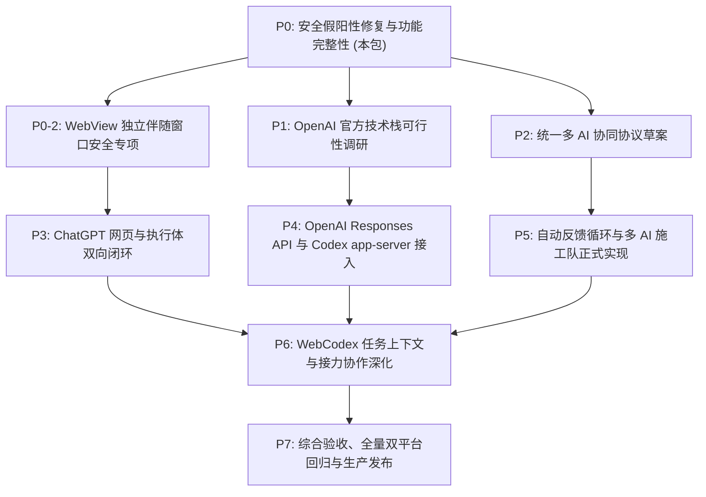

# AI Solo Studio 下一阶段协同开发技术指南与路线图 (2026)

**PROGRAM_ID：AISS-COLLABORATIVE-DEVELOPMENT-2026-001**  
**状态：** 正式制定  
**基准分支：** `rebuild`  
**基线 Commit：** `1b5fe769075e81c42275f4a7d0ff543335970442`  

---

## 1. 总体目标与产品愿景

AI Solo Studio 的核心使命是成为独立开发者的**本地可信研发控制中心**。  
下一阶段的核心任务，是建立以本 App 为受控枢纽的多 AI 协同研发体系。维护者已明确保留并推进四大核心方向：

1. **ChatGPT 官方视界与执行体多轮互通**：将 ChatGPT 官方网页讨论、个人订阅与底层执行体（Codex、Claude Code、Antigravity、DeepSeek 等）建立受控双向反馈与闭环。
2. **借鉴 WebCodex 工程思想**：在任务管理、多源上下文注入、受控执行、证据链留存、崩溃恢复与接力协作方面进行系统性吸收与工业级落地。
3. **拥抱 OpenAI 官方技术栈**：系统性接入并采用 OpenAI 官方 API、Responses API、Codex app-server、Sign in with ChatGPT 等正式标准。
4. **吸收优秀开源实践**：引入经过验证的成熟模式，提升单人研发效能与工程稳定性。

---

## 2. 现状能力矩阵 (Status Matrix)

| 功能模块 | 当前状态 | 现状说明 | 下一阶段目标 |
| :--- | :--- | :--- | :--- |
| **基础工程与双平台 CI** | ✅ 已恢复 | Ubuntu/macOS 双平台 CI 绿灯，Node 22 基准对齐 | 保持绿色基线，消除安全测试假阳性与字符串规避 |
| **主窗口安全基线 (ADR 0006)** | ✅ P0-1R 恢复 | 主窗口配置 `webviewTag: false`，安全断言基于真实生效代码 | P0-2 推出独立窗口沙箱隔离架构 |
| **ChatGPT 官方视界** | 🟡 界面已搭 / 受控隔离 | 已具备侧栏入口与方案提炼弹窗；主窗口安全隔离提示 | 建立独立隔离伴随窗口与受控双向通信桥接 |
| **SOP 研发蓝图** | 🟡 单一权威源确立 | 蓝图模板统一定义于渲染层，支持快速填充 Prompt | 扩展动态蓝图、项目级自定义模板与流水线编排 |
| **经验反思知识库 (RSI)** | 🟡 存储层已实现 | 底层磁盘原子读写与重启恢复完成，处于 `experimental_unintegrated` | 接入任务讨论与开工前的自动上下文注入 |
| **Codex CLI / app-server 适配** | 🟡 CLI 基础打通 | 支持 CLI 子进程受控调用、多轮对话与沙箱拦截 | 接入官方 Responses API 与标准 app-server 协议 |
| **DeepSeek / 第三方 API 适配** | ✅ 基础支持 | 支持自定义 OpenAI 兼容 API、官方端点校验 | 完善速率限制重试、流式响应与长任务心跳检测 |
| **自动反馈循环与多 AI 施工** | 🔴 概念在研 | 原工作树保留原型设计，未合入主线 | 制定统一协同协议，经 P3/P4 阶段稳步实现 |

---

## 3. 核心技术边界与安全防线

1. **ChatGPT 网页视界边界**：
   - 主应用窗口严禁开启 `webviewTag: true`。
   - ChatGPT 网页视界必须运行在专属独立窗口（Companion Window）或独立安全分区（`persist:ai_solo_chatgpt`）中。
   - 网页会话仅代表用户个人订阅登录态，**绝对不得**冒充为 App 后端官方 API 授权。
2. **官方 API 与凭证隔离边界**：
   - 官方 API 调用（OpenAI / DeepSeek / Claude）必须经由主进程的安全存储与网络通道，渲染层绝不持有或明文存储 API Key。
3. **执行体沙箱与权限边界 (Seatbelt)**：
   - 严禁任何绕过权限审查的参数（`--yolo`、`--trust` 等）。
   - 执行体对主项目的修改必须在独立 worktree 或受控任务副本中进行，经过验收并由用户批准后方可合并。
4. **持久化唯一写入者边界 (ADR 0005/0006)**：
   - `.studio/` 数据与状态记录只能通过持久化服务与原子写原语提交，渲染层与执行体不得直接操作文件系统。

---

## 4. 分阶段实施顺序与依赖关系 (Roadmap)

### 阶段定义与停止条件

- **P0（本包）：安全假阳性修复与功能完整性**
  - 交付：清除 `webviewTag` 伪装；恢复 `LearningEngine` 磁盘持久化；建立外部 URL 批准清单；消除 SOP 冗余；全量单测与 macOS E2E 通过。
  - 停止条件：PR 创建并标记 `AISS_REBUILD_P0_1R_INTEGRITY_001_COMPLETE`，等待独立审查与合并。
- **P0-2：WebView 独立伴随窗口安全专项**
  - 目标：将 ChatGPT 网页移入主进程管理的独立 BrowserWindow 伴随窗口，配置独立的 WebContents 权限审查、CSP、导航白名单与 OAuth 弹窗拦截，彻底隔离主渲染层。
- **P1：OpenAI 官方技术栈可行性调研**
  - 目标：产出 `docs/reports/2026-11-openai-official-feasibility.md`，深度评估 Responses API、OAuth 认证流与订阅额度适用范围。
- **P2：统一多 AI 协同协议制定**
  - 目标：产出 `docs/plans/2026-11-unified-collaboration-protocol.md`，定义标准任务工单、证据规范、评审意见与多轮反馈数据模型。
- **P3：ChatGPT 网页与执行体受控双向闭环**
  - 目标：支持从网页提取对话转化为工单，并将执行体运行日志、测试断言反向呈递给 ChatGPT 进行复核。
- **P4：OpenAI 官方 API 与 Codex app-server 正式集成**
  - 目标：支持标准 app-server 协议握手、工具调用与流式执行。
- **P5：自动反馈循环与多 AI 施工队**
  - 目标：落地多智能体分工（主程序员 + 审查员 + 测试员），实现自动重试与反思知识库自动注入。

---

## 5. 待决策事项 (Decisions Needed from Maintainer)

1. **ChatGPT 网页视界交互形态**：采用 Electron 独立伴随窗口（可并排停靠/独立拖动）还是受控 WebContents 嵌入？（推荐：独立伴随窗口，安全隔离最彻底）。
2. **OpenAI 官方接入优先路径**：优先支持用户配置自有 API Key，还是优先打通 Sign in with ChatGPT 官方 OAuth？
3. **自动反馈循环的单任务重试上限**：默认设定为最多自动重试 3 次还是 5 次，并在遇到何种级别错误时必须强制暂停请求人工介入？

---

## 6. 与既有规范的差异说明与增量修订计划

- **ADR 0005 / 0006 增量附录**：将 `LearningStore` 明确列入持久化层支持的工程数据集合，路径规范化为 `.studio/learnings.json`。
- **UI v2.1 增量规范**：更新关于 ChatGPT 视界的视口规范，将原主窗口标签页方案修订为安全伴随窗口或受控桥接卡片。
